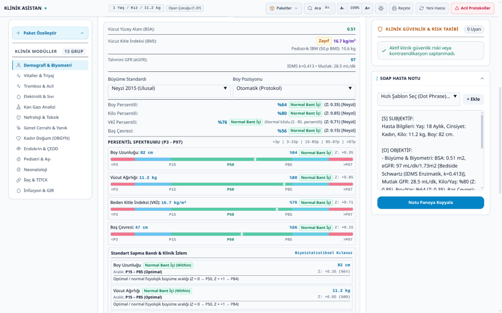
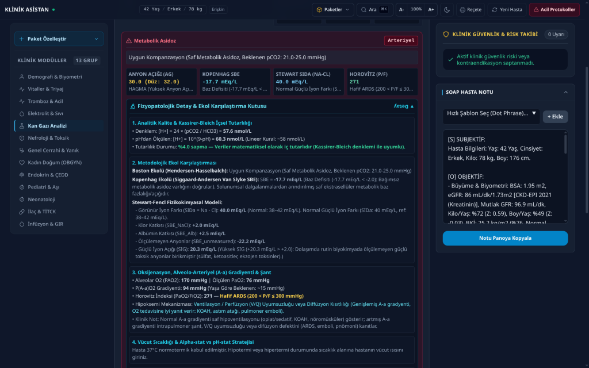
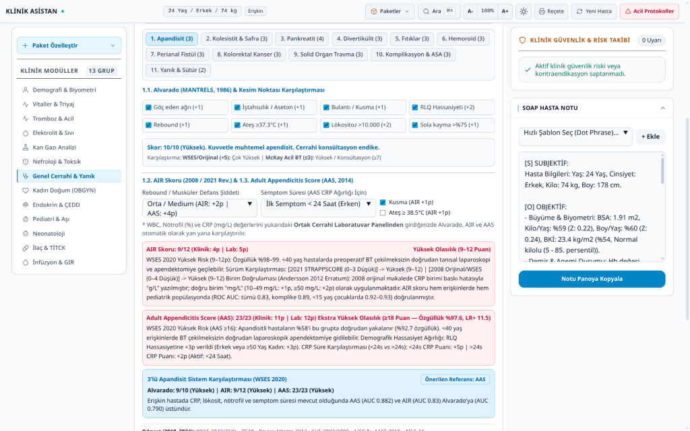
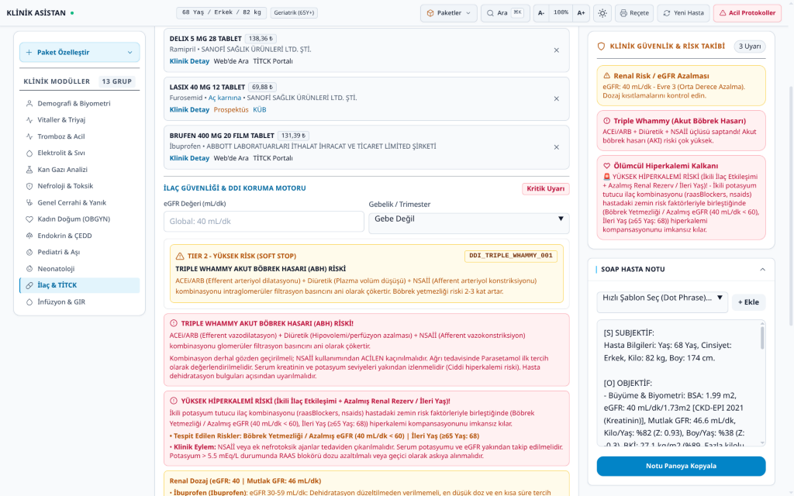
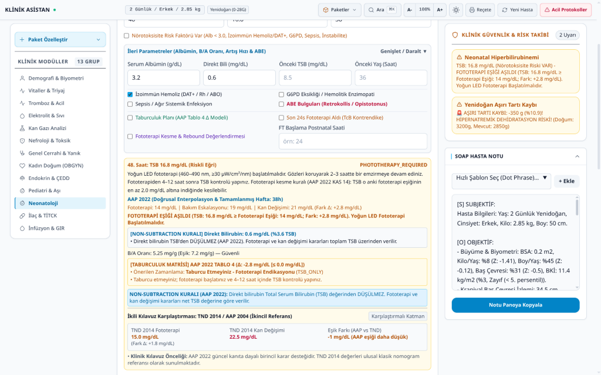
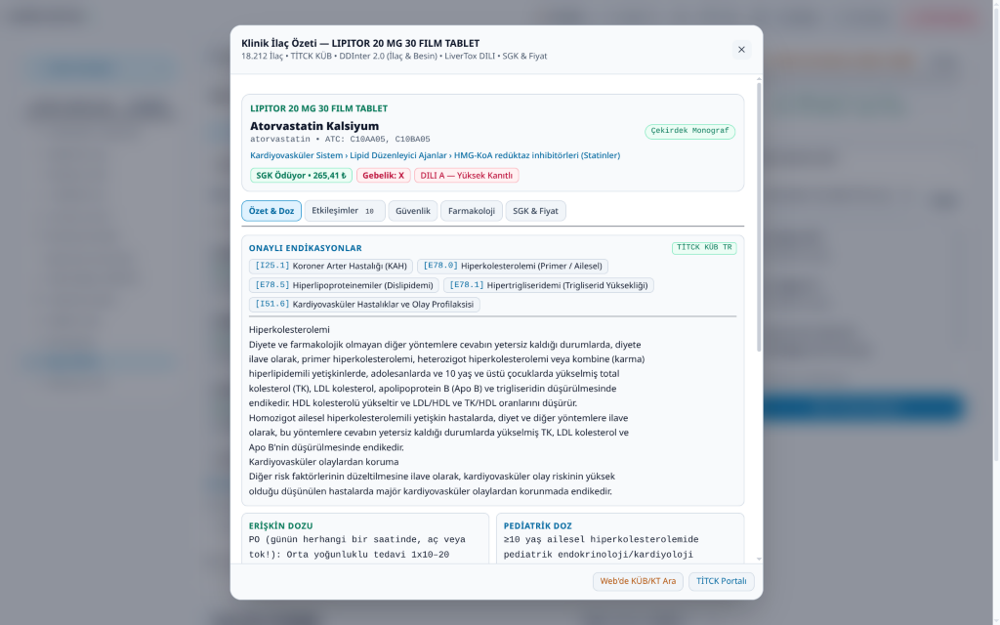
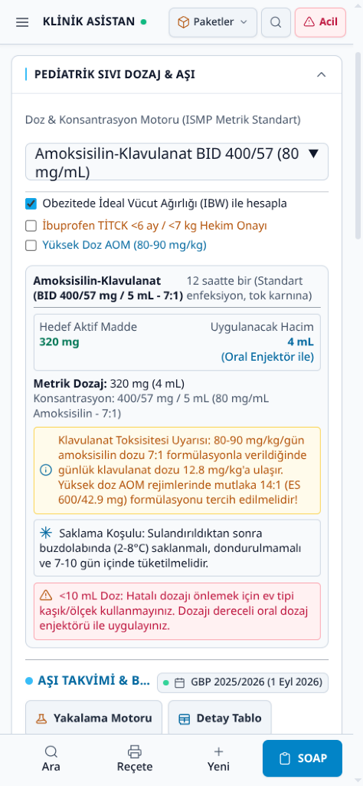
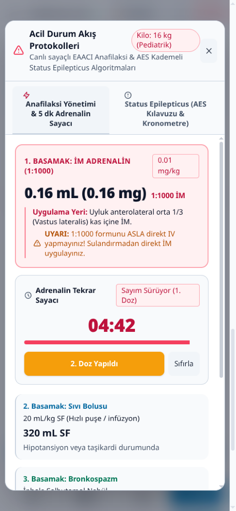

# Klinik Karar Destek Asistanı (Klinik PWA)

[](https://www.typescriptlang.org/)
[](https://vitejs.dev/)
[](https://web.dev/progressive-web-apps/)
[](LICENSE)
[](https://www.titck.gov.tr/)
[](https://github.com/VelliDR/klinik-pwa-deneme)
[](https://github.com/VelliDR/klinik-pwa-deneme/actions/workflows/deploy.yml)
[-blue)](https://kvkk.gov.tr/)

Klinik Karar Destek Asistanı; acil servis, poliklinik ve yataklı servislerde görev yapan hekimler ve sağlık çalışanları için tasarlanmış, açık kaynaklı ve çevrimdışı öncelikli (offline-first) bir klinik hesaplama, akılcı ilaç güvenliği ve dokümantasyon aracıdır.

Projenin temel amacı; yoğun klinik çalışma temposunda sık başvurulan kılavuz algoritmalarını, pediatrik ve erişkin dozaj hesaplamalarını, çoklu ilaç etkileşim denetimini ve epikriz dokümantasyonunu tek bir arayüzde toplayarak hekimin karar verme sürecine pratik ve güvenilir bir asistan sunmaktır.

**Canlı Uygulama (PWA):** [vellidr.github.io/klinik-pwa-deneme](https://vellidr.github.io/klinik-pwa-deneme/) — Doğrudan tarayıcıda çalışır; masaüstü ve mobil cihazlara çevrimdışı uygulama olarak kurulabilir.

### Öne Çıkan Kapsam
- **22 klinik karar destek motoru:** Biyometri ve persentil (WHO / Neyzi 2015), eGFR (Schwartz / CKD-EPI 2021), 3 ekollü kan gazı analizi (Boston · Kopenhag · Stewart-Fencl), AAP 2022 / TND 2014 yenidoğan sarılığı, pediatrik şurup dozlama, GBP 2026 **tam ve kısmi aşılı (`custom_partial`)** aşı yakalama motoru, 10 başlıkta 30 genel cerrahi skorlama sistemi ve genişletilmiş dahiliye skorları (Child-Pugh, MELD 3.0, NIHSS, ABCD², SOFA/qSOFA, Glasgow-Blatchford).
- **Web Worker destekli yerel TİTCK ilaç, barkod, W3C PDDI-CDS ve takviye/bitki çayı etkileşim katmanı:** `2026-11-21` veri anlık görüntüsüyle 18.212 ruhsatlı ilaç (`6.664` kayıpsız arşiv/doğrudan KÜB/KT PDF, `1.224` Ek İzlem, `1.108` soğuk zincir), arka plan `Web Worker` araması, talep üzerine yüklenen (lazy-loaded) kamera ile **EAN-13 / İTS 2D karekod tarama**, 1.794 ATC / 1.798 ICD-10 endikasyon eşlemesi, 5 sekmeli monograf (yapılandırılmış `organ_impairment` renal/hepatik tabloları + `atcKnowledgeEngine` yedeği), 1.198 ATC Türkçe KÜB bölümü, **3.045 kanıtlı W3C PDDI-CDS etkileşim monografı**, 1.084 ATC / 81.355 kurallı DDI matrisi, ana aramayı kalabalıklaştırmayan **izole Takviye, Vitamin & Bitki Çayı etkileşim ve kümülatif yığılma modülü (`44` bileşen · `85` canlı doğrulanmış kural · sıfır gürültü)** ve renal/hepatik (Child-Pugh + DILI) güvenlik kalkanı.
- **Canlı SOAP notu, 17 yuvalı güvenlik denetçisi, sentetik vakalar ve A4 çizelge:** Genişletilmiş dahiliye skorlarının SOAP `[A]`/`[P]` bölümlerine ve sağ paneldeki 17 yuvalı canlı güvenlik takipçisine (kritik triyaj, kan gazı pH ve ağır preeklampsi dâhil) aktarılması, 10 hazır klinik paket (`Dahiliye, Hepato & YBÜ` dâhil), 24 maddelik hızlı komut paleti (`Ctrl+K`), 5 anonim sentetik örnek vaka ve TİTCK otomatik tamamlamalı A4 ilaç çizelgesi.
- **Acil durum akışları:** Kilo bazlı IM adrenalin dozajı ile 5 dakikalık canlı anafilaksi sayacı ve AES kademeli status epileptikus kronometresi.
- **İstemci taraflı gizlilik ve kontrollü çevrimdışı çalışma:** Hasta verisi sunucuya gönderilmez; Workbox kademeli precache ve hekim onaylı (`prompt`) Service Worker güncelleme stratejisi ile muayene ortasında istemsiz sayfa yenilemesi engellenir.

<details>
<summary>English Summary</summary>

**Klinik Karar Destek Asistanı (Klinik PWA)** is an open-source, offline-first clinical decision support and medical education Progressive Web App built with TypeScript and Vite for Turkish clinical practice.

- **22 Clinical Modules:** Pediatric growth percentiles (WHO & Neyzi 2015), eGFR (Schwartz & CKD-EPI 2021), three-school blood gas interpretation (Boston, Copenhagen SBE, Stewart-Fencl), AAP 2022 / TND 2014 neonatal hyperbilirubinemia, weight-based pediatric syrup dosing, Turkish national full and partial (`custom_partial`) vaccination catch-up (GBP 2026), 30 general surgery scoring systems across 10 domains, and extended internal medicine scores (Child-Pugh, MELD 3.0, NIHSS, ABCD², SOFA/qSOFA, Glasgow-Blatchford).
- **Web Worker Drug Safety, W3C PDDI-CDS & Supplement/Herbal Layer:** Client-side catalog of 18,212 Turkish-licensed medications (TİTCK, `2026-11-21` snapshot) searched off the main thread via a dedicated Web Worker with main-thread fallback, lazy-loaded EAN-13 / İTS 2D barcode scanner, ICD-10 indication search, 5-tab monographs with structured renal/hepatic `organ_impairment` tables, 1,198 Turkish SmPC (KÜB) sections, **3,045 evidence-linked W3C PDDI-CDS interaction monographs**, an isolated zero-noise **Supplement, Vitamin & Herbal Tea interaction & cumulative stacking module** (`44` Turkish-practice botanicals/supplements, `66` drug–supplement + `19` cumulative stacking rules, `159` live-verified citations), and an O(1) interaction engine combining 28 curated rules with 81,327 DDInter 2.0 pairs.
- **Privacy & Offline Support:** 100% client-side execution with zero telemetry; patient data never leaves the browser, and prompt-driven Service Worker updates prevent unprompted mid-consultation reloads.
- **Live Demo:** https://vellidr.github.io/klinik-pwa-deneme/
- **Disclaimer:** Intended strictly as an educational and clinical reference aid for healthcare professionals; all calculations and drug decisions must be independently verified by a licensed physician.

</details>

---

> [!IMPORTANT]
> ### Klinik ve Yasal Sorumluluk Reddi (Disclaimer)
> Bu uygulama, yalnızca **tıp hekimleri, asistan hekimler, tıp öğrencileri ve yetkili sağlık profesyonellerine yönelik bir klinik karar destek ve eğitim aracıdır**.
> 
> Uygulamada yer alan hesaplama sonuçları, dozaj önerileri, etkileşim uyarıları ve skorlama yorumları bir hekimin bağımsız klinik muhakemesi, hasta başı fizik muayenesi ve profesyonel tıbbi değerlendirmesi yerine geçemez. İlaç uygulamaları, sıvı tedavileri ve klinik kararlar her zaman hastanın bireysel özelliklerine, alerji öyküsüne, güncel laboratuvar verilerine ve resmi ürün kılavuzlarına (KÜB/KT) göre sorumlu hekim tarafından doğrulanmalıdır.

---

## Uygulama Ekran Görüntüleri

Masaüstü iş istasyonu görünümü (sol tarafta 13 klinik modül grubu, ortada reaktif karar destek motoru, sağda canlı güvenlik alarmları ve otomatik SOAP hasta notu), Aydınlık / Karanlık tema desteği, 5 sekmeli ilaç monografı ve mobil PWA görünümünden örnekler:

### 1. Biyometri, Pediatrik Persentil Spektrumu ve Canlı SOAP (Aydınlık Mod)
18 aylık bir pediatrik olguda Mosteller BSA, IDMS yatakbaşı Schwartz eGFR (mutlak GFR dâhil), Neyzi 2015 ulusal büyüme standartlarına göre renk kodlu persentil spektrum çubukları ve sağ panelde eşzamanlı güncellenen canlı SOAP hasta notu.



### 2. Kan Gazı Analizi ve 3'lü Fizyopatolojik Asit-Baz Motoru (Karanlık Mod)
Gece nöbeti karanlık temasında yüksek anyon açıklı metabolik asidoz (HAGMA) olgusu: Winter kompanzasyonu, albümin düzeltmeli anyon açığı (Figge), Kassirer-Bleich iç tutarlılık denetimi, Boston · Kopenhag SBE · Stewart-Fencl ($\text{SID}_a$/$\text{SIG}$) ekol karşılaştırması ve $A\text{-}a$ gradiyenti / Berlin ARDS analizi.



### 3. Genel Cerrahi İş İstasyonu — 11 Sekme ve 3'lü Akut Apandisit Karşılaştırması
10 klinik başlıkta 30 cerrahi skorlama sistemini bir araya getiren iş istasyonu: ortak laboratuvar senkronizasyonuyla Alvarado (MANTRELS), AIR (2008 / 2021 STRAPPSCORE) ve Adult Appendicitis Score (AAS) sistemlerinin WSES 2020 kılavuzu altında yan yana değerlendirilmesi.



### 4. Akılcı Reçete, TİTCK İlaç Kataloğu ve 4 Kademeli Etkileşim Kalkanı
Evre 3 KBH ($\text{eGFR } 40\text{ mL/dk}$) olan 68 yaşındaki hastada Ramipril + Furosemid + İbuprofen reçetesine karşı eşzamanlı tetiklenen Triple Whammy (Tier 2 Soft Stop), Ölümcül Hiperkalemi Kalkanı, KDIGO renal doz uyarısı ve sağ sütundaki canlı güvenlik takip paneli.



### 5. Neonatoloji — AAP 2022 Hiperbilirubinemi ve Yenidoğan Tartı Kaybı Takibi
48 saatlik, 38 haftalık ve DAT(+) izoimmün hemoliz riskli yenidoğanda AAP 2022 fototerapi / bakım eskalasyonu / kan değişimi eşikleri, Non-Subtraction kuralı, Bilirubin/Albümin oranı, Tablo 4 taburculuk matrisi, TND 2014 ikili kılavuz kıyaslaması ve %10,9 aşırı tartı kaybı alarmı.



### 6. 5 Sekmeli TİTCK Klinik Monograf Modalı (KÜB, ICD-10, DILI ve SGK)
Atorvastatin örneğinde 5 sekmeli (`Özet & Doz`, `Etkileşimler`, `Güvenlik`, `Farmakoloji`, `SGK & Fiyat`) çevrimdışı klinik monograf görünümü: onaylı ICD-10 endikasyon etiketleri, resmi Türkçe TİTCK KÜB metni, gebelik / LiverTox DILI rozetleri ve erişkin-pediatrik dozaj özeti.



### 7. Mobil PWA Görünümü (Pediatrik Şurup Dozajı ve Acil Anafilaksi Sayacı)
Telefon boyutunda (`390×844`) 4 yaşında / 16 kg pediatrik olgu üzerinden iki yatak başı görünüm: solda kilo bazlı şurup dozlama (`mL` / oral enjektör, klavulanat toksisite ve saklama uyarıları, GBP 2025/2026 erişimi), sağda kilo bazlı İM adrenalin dozajı ile 5 dakikalık canlı geri sayım ve sıvı bolusu.

| Pediatrik Şurup Dozlama & Aşı Erişimi | Acil Anafilaksi & 5 dk Adrenalin Sayacı |
| :---: | :---: |
|  |  |

---

## İçindekiler

- [Uygulama Ekran Görüntüleri](#uygulama-ekran-görüntüleri)
- [Tasarım ve Arayüz İlkeleri](#tasarım-ve-arayüz-ilkeleri)
- [Hızlı Başlangıç ve PWA Kurulumu](#hızlı-başlangıç-ve-pwa-kurulumu)
- [Klinik Karar Destek Motorları (22 Modül)](#klinik-karar-destek-motorları-22-modül)
  - [1. Demografi, Doğum Tarihi ve Gestasyonel Yaş](#1-demografi-doğum-tarihi-ve-gestasyonel-yaş)
  - [2. Biyometri, Mosteller BSA ve eGFR (KDIGO 2024 / Schwartz / CKD-EPI)](#2-biyometri-mosteller-bsa-ve-egfr-kdigo-2024--schwartz--ckd-epi)
  - [3. Vital Bulgular ve Triyaj Skorları (NEWS2 / PEWS / AAP 2017 BP)](#3-vital-bulgular-ve-triyaj-skorları-news2--pews--aap-2017-bp)
  - [4. Bilinç ve Nöroloji Skorlaması (GCS ve Pediatrik pGCS)](#4-bilinç-ve-nöroloji-skorlaması-gcs-ve-pediatrik-pgcs)
  - [5. Tromboemboli ve Kardiyovasküler Skorlar (Wells / PERC / HEART / AF)](#5-tromboemboli-ve-kardiyovasküler-skorlar-wells--perc--heart--af)
  - [6. Nefroloji, Toksikoloji ve Enfeksiyon (FENa / FEUrea / NAC / CURB-65)](#6-nefroloji-toksikoloji-ve-enfeksiyon-fena--feurea--nac--curb-65)
  - [7. Yenidoğan ve Hiperbilirubinemi (AAP 2022 / TND 2014 / Maisels)](#7-yenidoğan-ve-hiperbilirubinemi-aap-2022--tnd-2014--maisels)
  - [8. Kan Gazı Analizi ve Fizyopatolojik Asit-Baz Motoru (ABG / VBG)](#8-kan-gazı-analizi-ve-fizyopatolojik-asit-baz-motoru-abg--vbg)
  - [9. İdame Sıvı Tedavisi (Holliday-Segar ve TND Yenidoğan)](#9-idame-sıvı-tedavisi-holliday-segar-ve-tnd-yenidoğan)
  - [10. Sıvı-Elektrolit Dengesi (Adrogué-Madias Sodyum ve Kalsiyum)](#10-sıvı-elektrolit-dengesi-adrogué-madias-sodyum-ve-kalsiyum)
  - [11. Kardiyoloji ve EKG Analizi (QTc / Aks / Tisdale Risk Skoru)](#11-kardiyoloji-ve-ekg-analizi-qtc--aks--tisdale-risk-skoru)
  - [12. Endokrinoloji ve Glukokortikoid Eşdeğerlik Dönüşümü](#12-endokrinoloji-ve-glukokortikoid-eşdeğerlik-dönüşümü)
  - [13. İnfüzyon Hızı ve Glukoz İnfüzyon Hızı (GIR)](#13-infüzyon-hızı-ve-glukoz-infüzyon-hızı-gir)
  - [14. Pediatrik Büyüme, Persentil ve Kraniyal Tarama (NICE / WHO / Neyzi 2015)](#14-pediatrik-büyüme-persentil-ve-kraniyal-tarama-nice--who--neyzi-2015)
  - [15. Pediatrik Demir Eksikliği ve Talasemi Ayrımı (TPHD ve Mentzer)](#15-pediatrik-demir-eksikliği-ve-talasemi-ayrımı-tphd-ve-mentzer)
  - [16. Pediatrik Şurup ve Süspansiyon Dozlama Motoru](#16-pediatrik-şurup-ve-süspansiyon-dozlama-motoru)
  - [17. Türkiye Ulusal ve Özel Bağışıklama Protokolleri (GBP 2026)](#17-türkiye-ulusal-ve-özel-bağışıklama-protokolleri-gbp-2026)
  - [18. Centor / McIsaac Farenjit Değerlendirmesi](#18-centor--mcisaac-farenjit-değerlendirmesi)
  - [19. Kadın Doğum ve Obstetrik Hesaplayıcı (Naegele / Bishop / Preeklampsi)](#19-kadın-doğum-ve-obstetrik-hesaplayıcı-naegele--bishop--preeklampsi)
  - [20. Genel Cerrahi Sınıflandırmaları, Skorlamaları ve Yanık Resüsitasyonu (10 Başlık • 30 Sistem • 8 Errata)](#20-genel-cerrahi-sınıflandırmaları-skorlamaları-ve-yanık-resüsitasyonu-10-başlık--30-sistem--8-errata)
  - [21. Akılcı Reçete, İlaç Güvenliği ve Etkileşim Denetimi](#21-akılcı-reçete-ilaç-güvenliği-ve-etkileşim-denetimi)
  - [22. Genişletilmiş Dahiliye Skorları (Hepatoloji, Nöroloji, Sepsis & Üst GİS Kanama)](#22-genişletilmiş-dahiliye-skorları-hepatoloji-nöroloji-sepsis--üst-gis-kanama)
- [Canlı SOAP Klinik Notu Sentezi](#canlı-soap-klinik-notu-sentezi)
- [TİTCK İlaç Kataloğu, Endikasyon / ICD-10 Arama ve Klinik Monograflar](#titck-ilaç-kataloğu-endikasyon--icd-10-arama-ve-klinik-monograflar)
- [Acil Durum Protokolleri ve Canlı Zamanlayıcılar](#acil-durum-protokolleri-ve-canlı-zamanlayıcılar)
- [A4 Hasta Reçete ve Dozaj Çizelgesi](#a4-hasta-reçete-ve-dozaj-çizelgesi)
- [Gizlilik ve Veri Güvenliği (KVKK / GDPR)](#gizlilik-ve-veri-güvenliği-kvkk--gdpr)
- [Geliştirici ve Kurulum Rehberi](#geliştirici-ve-kurulum-rehberi)
- [Geliştirici ve Lisans](#geliştirici-ve-lisans)

---

## Tasarım ve Arayüz İlkeleri

1. **Ağırbaşlı ve Odaklı Klinik Tipografi:** Uzun nöbet ve poliklinik kullanımında gözü yormayan mat renk paletleri, düşey hizalı sayısal tipografi (`tabular-nums`) ve okunabilir yazı ölçekleme (`fontScaleManager`) tercih edilmiştir.
2. **Yatak Başında 15 Saniye Kuralı (İkincil Akademik Katman):** Her branş kartının ilk ekranı güncel konsensüs kılavuzuyla doğrudan sonuca ulaşacak yalınlıkta kurgulanır. Kan gazı üçlü ekol/8 basamak ayrımı (`<details>`), Genel Cerrahi sürüm/erratum kıyaslama seçicileri (`Sürüm Kıyasla` anahtarı + kılavuz modalı) ve KÜB derin metinleri isteğe bağlı ikincil katmanda tutulur.
3. **Saf SVG İkonografisi ve Sakin Geçişler:** İşletim sistemi emojileri yerine ölçeği sabit inline SVG ikonlar ve kısa, dikkat dağıtmayan durum geçişleri (`140ms ease`) kullanılır.
4. **Çift Tema Desteği:** Poliklinik gündüz aydınlatması için yüksek kontrastlı Aydınlık Mod (`Light Theme`) ve gece nöbetleri için koyu arduvaz Karanlık Mod (`Dark Theme`).
5. **Şeffaf Kılavuz Kaynakçası ve Veri Güncelliği Ayrımı:** `#card-asi` dâhil **21 klinik modül kartının** tamamında ilgili modülün dayandığı birincil kılavuz ve yıl bilgisi (`guidelineRegistry.ts`) kaynakça rozeti olarak otomatik yerleştirilir. Zamana dirençli klinik hesaplama denklemleri ile hızla değişebilen yerel piyasa/mevzuat verileri (TL fiyat, GKF €, 4 kademeli KKİ, SGK EK-4/A, GBP takvimi) **tıklanabilir Veri Anlık Görüntüsü Tarihi baloncuğu** (`data_manifest.json`) ve 3–6 ay eskime uyarılarıyla ayrıştırılır.
6. **Kademeli Çevrimdışı Mimari ve Kontrollü Güncelleme (Tiered Offline-First):** Workbox çekirdek precache yalnızca uygulama kabuğu, Web Worker arama paketi ve hızlı ilaç/etkileşim/takviye çekirdeğini (17 tekil girdi, mükerrer kayıtsız) ilk kurulumda indirir; ağır katmanlar (`clinical_monographs_master.json` + 14 Türkçe KÜB parçası, ~17.5 MB ham) talep üzerine `CacheFirst` ile önbelleklenir ve isteyen kullanıcı tek tıkla **"Tam Çevrimdışı KÜB Paketi"** olarak cihazına indirebilir. VitePWA `registerType: 'prompt'` stratejisi sayesinde yeni sürümler muayene ortasında sayfayı aniden yenilemez; hekim onaylı güncelleme bildirimiyle (`SKIP_WAITING`) etkinleştirilir.
7. **Klinik Ergonomi ve Akıllı Reaktivite:** Veri girişleri reaktif hesaplanır; ortak laboratuvar/vital değerleri alt motorlara aktarılırken canlı tarayıcıda tamamen gizli kalan yan branş motorları gereksiz yere yeniden hesaplanmaz, ancak aktif güvenlik uyarıları hasta sıfırlama sonrasında gizli kartlarda dahi eksiksiz temizlenir.
8. **Modüler İş İstasyonu Yapısı:** Farklı uzmanlık alanlarına (Pediatri, Acil, Yoğun Bakım, `Dahiliye, Hepato & YBÜ`, Genel Cerrahi, Kadın Doğum vb.) uygun **10 hazır klinik paket**, **24 maddelik Hızlı Komut Paleti (`Ctrl+K` — 23 klinik motor + 1 hızlı sıfırlama)** ve kullanıcıya özel `localStorage` kart kombinasyonları sunulur; yeni puan toplamalı staj skorları için bildirimsel şema yardımcısı (`declarativeScoreEngine.ts`) sağlanır.

---

## Hızlı Başlangıç ve PWA Kurulumu

Uygulama standart bir modern web tarayıcısı üzerinden doğrudan çalıştırılabilir. Progressive Web App (PWA) desteği sayesinde masaüstü veya mobil cihazlarda yerel bir yazılım gibi yüklenebilir:

- **Canlı Uygulama:** [https://vellidr.github.io/klinik-pwa-deneme/](https://vellidr.github.io/klinik-pwa-deneme/)
- **Yükleme:** Tarayıcı adres çubuğundaki *"Yükle"* simgesini veya tarayıcı menüsündeki *"Ana Ekrana Ekle"* seçeneğini kullanabilirsiniz.

---

## Klinik Karar Destek Motorları (22 Modül)

### 1. Demografi, Doğum Tarihi ve Gestasyonel Yaş
- **Kronolojik Yaş:** Gün, ay ve yıl bazında hassas yaş hesaplaması.
- **Prematüre Düzeltilmiş Yaş:** $<37$ gestasyonel haftada doğan bebeklerde düzeltilmiş ay ve hafta hesabı; persentil eğrilerine otomatik uyarlama.
- **Postnatal Saat:** Yenidoğan sarılığı değerlendirmesinde ilk 14 gün (336 saat) için saat bazlı yaş takibi.

### 2. Biyometri, Mosteller BSA ve eGFR (KDIGO 2024 / Schwartz / CKD-EPI)
- **Vücut Yüzey Alanı (BSA):** Mosteller formülü ($\text{BSA} = \sqrt{\frac{\text{Boy (cm)} \times \text{Kilo (kg)}}{3600}}$).
- **Pediatrik eGFR ($<18$ yaş):** IDMS izlenebilir yatakbaşı Schwartz ($k=0.413$) veya klasik Jaffe tahlil seçimi; $<1$ yaş bebeklerde term ($k=0.45$) ve prematüre ($k=0.33$) sabitleri.
- **Erişkin eGFR ($\ge 18$ yaş):** KDIGO 2024 önerili 2021 CKD-EPI Kombine Kreatinin + Sistatin C ($\text{eGFR}_{\text{cr-cys}}$), izole Kreatinin veya izole Sistatin C denklemleri.
- **Dozlama İçin Mutlak GFR:** Obez ve kaşektik hastalarda dar terapötik indeksli ilaçlar için BSA de-indekslemesi ($\text{eGFR}_{\text{mutlak}} = \text{eGFR} \times \frac{\text{BSA}}{1.73}\text{ mL/dk}$).

### 3. Vital Bulgular ve Triyaj Skorları (NEWS2 / PEWS / AAP 2017 BP)
- **NEWS2 (National Early Warning Score 2):** Erişkin hastalarda solunum sayısı, $\text{SpO}_2$, oksijen desteği, sistolik tansiyon, nabız, bilinç düzeyi ve ateş üzerinden klinik dekompansasyon risk analizi.
- **Pediatrik PEWS:** Yaşa göre fizyolojik parametrelerden pediatrik erken uyarı puanlaması.
- **AAP 2017 Pediatrik Tansiyon:** Yaş, cinsiyet ve boy persantiline göre normotansif, evre 1 ve evre 2 hipertansiyon evrelemesi.

### 4. Bilinç ve Nöroloji Skorlaması (GCS ve Pediatrik pGCS)
- **Erişkin GCS:** Göz açma, sözel yanıt ve motor yanıt bileşenleri (3–15 puan).
- **Pediatrik pGCS ($<2$ yaş):** Konuşma öncesi (preverbal) çocuklara uygun sözel ve motor değerlendirme kriterleri.

### 5. Tromboemboli ve Kardiyovasküler Skorlar (Wells / PERC / HEART / AF)
- **Wells DVT ve Wells PTE:** Derin ven trombozu ve pulmoner emboli klinik olasılık skorlamaları.
- **PERC Kuralı:** Düşük riskli olgularda gereksiz D-Dimer ve radyolojik tetkik yükünü azaltmaya yönelik dışlama kriterleri.
- **HEART Skoru:** Acil servise göğüs ağrısıyla başvuran hastalarda 6 haftalık majör kardiyak olay (MACE) risk analizi.
- **CHA₂DS₂-VASc ve HAS-BLED:** Atriyal fibrilasyon hastalarında inme riski ile antikoagülan kullanımına bağlı majör kanama riski dengesi.

### 6. Nefroloji, Toksikoloji ve Enfeksiyon (FENa / FEUrea / NAC / CURB-65)
- **FENa ve FEUrea:** Prerenal azotemi ile Akut Tubuler Nekroz (ATN) ayrımı; diüretik kullanan hastalarda FEUrea önceliği.
- **Düzeltilmiş Sodyum (Katz ve Hillier):** Hiperglisemi varlığında ölçülen sodyumun düzeltilmesi ve osmolal açık hesabı.
- **Rumack-Matthew Nomogramı ve NAC:** Parasetamol intoksikasyonunda saat bazlı toksisite değerlendirmesi ve pediatrik sıvı kısıtlamalı 3 kademeli IV NAC protokolü.
- **CURB-65 ve CRB-65:** Toplum kökenli pnömoni ciddiyet derecesi ve ayaktan/yatarak takip önerisi.

### 7. Yenidoğan ve Hiperbilirubinemi (AAP 2022 / TND 2014 / Maisels)
- **AAP 2022 Rehberi (Varsayılan):**
  - 35–40+ gebelik haftaları ve nörotoksisite risk faktörlerine göre saatlik fototerapi ve kan değişimi eşikleri (doğrusal enterpolasyonlu).
  - Bakım eskalasyonu acil protokolü (`Kan Değişimi Eşiği - 2.0 mg/dL`).
  - Bilirubin/Albümin (B/A) oranı kontrolü.
  - TcB doğrulaması (fototerapi eşiğine $\le 3\text{ mg/dL}$ farkta TSB doğrulama uyarısı).
  - Fototerapi sonlandırma ve rebound izlem aralıkları (KAS 14-15).
  - Taburculuk sonrası kontrol zamanlama matrisi (AAP 2022 Tablo 4).
- **TND 2014 / AAP 2004 Klasik Mod:** Türk Neonatoloji Derneği eğrileriyle karşılaştırmalı değerlendirme seçeneği.
- **Maisels 2012 Preterm Yaklaşımı:** $<35$ hafta prematüre bebeklerde postmenstrüel yaşa göre fototerapi ve kan değişimi eşikleri.
- **Fizyolojik/Patolojik Kilo Kaybı:** Doğum ağırlığına göre yüzde kaybı hesabı ($>\%10$ uyarı sinyali).
- **APGAR Skoru:** 1. ve 5. dakika resüsitasyon değerlendirmesi.
- **Westley Krup Skoru ve CDS Dehidratasyon Skalası.**

### 8. Kan Gazı Analizi ve Fizyopatolojik Asit-Baz Motoru (ABG / VBG)
- **3 Ekolün Eş Zamanlı Analizi (Boston, Kopenhag ve Stewart-Fencl):**
  - **Boston Ekolü (Henderson-Hasselbalch):** Primer asidoz/alkaloz tespiti, fizyolojik kompanzasyon sınırları (Winter formülü $pCO_2 = 1.5 \times HCO_3 + 8 \pm 2$, metabolik alkaloz kuralı $pCO_2 = 0.7 \times \Delta HCO_3 + 40 \pm 2$, akut/kronik respiratuar 1-4-2-5 kompanzasyon katsayıları) ve aşırı kompanzasyon imkansızlığı kalkanı.
  - **Kopenhag Ekolü (Siggaard-Andersen Van Slyke SBE):** $\text{SBE} = (HCO_3 - 24.8) + 16.2 \times (pH - 7.40)$ denklemiyle solunumsal dalgalanmalardan arındırılmış saf ekstrasellüler standart baz fazlalığı/açığı (normal referans: $-2$ ila $+2\text{ mEq/L}$).
  - **Stewart-Fencl Fizikokimyasal Modeli:**
    - Görünür İyon Farkı: $\text{SID}_a = [Na^+] - [Cl^-]$ (Normal: $38 - 42\text{ mEq/L}$). Düşük $\text{SID}_a$ ile iyatrojenik hiperkloremik asidoz (SF yüklemesi) ayrımı.
    - SBE Bileşen Ayrıştırması: Klor katkısı ($\text{SBE}_{Na-Cl}$), albümin tamponu ($\text{SBE}_{Alb}$) ve ölçülemeyen anyonlar ($\text{SBE}_{\text{unmeasured}}$).
    - Güçlü İyon Açığı: $\text{SIG} = \text{SID}_a - \text{SID}_e$ ile gizli patolojik anyon tespiti.
- **İç Kalite ve Kassirer-Bleich Doğrulaması:**
  - $[H^+] = 24 \times \frac{pCO_2}{HCO_3}\text{ nmol/L}$ ile ölçülen $[H^+] = 10^{(9-pH)}$ ve yatak başı kuralı $[H^+] \approx 80 - (\text{pH ondalığı})$ kıyaslaması; sapma $>\%10$ ise analizör kalibrasyonu veya preanalitik numune hatası uyarısı.
- **Anyon Açığı (AG), Figge Albümin Düzeltmesi ve Delta Analizi:**
  - Hipoalbüminemi ile maskelenen gizli HAGMA'ların tespiti ($\text{Düz. AG} = \text{AG} + 2.5 \times (4.0 - \text{Albüm})$).
  - $\Delta/\Delta$ Delta oranı ($\Delta\text{AG} / \Delta\text{HCO}_3$) ve $\Delta\text{Gap} = \Delta\text{AG} - \Delta\text{HCO}_3$ ile mikst HAGMA + NAGMA veya HAGMA + Metabolik Alkaloz üçlü bozukluk taraması.
- **Oksijenasyon, Alveolo-Arteriyel ($A\text{-}a$) Gradiyenti ve Berlin ARDS:**
  - Alveolar Gaz Denklemi ($PAO_2 = FiO_2 \times (P_B - 47) - \frac{PaCO_2}{0.8}$).
  - Ölçülen ve yaşa göre beklenen $A\text{-}a$ gradiyenti ($(\text{Yaş}/4) + 4$) ile hipoksemi mekanizma ayrımı: Normal $A\text{-}a$ (Saf hipoventilasyon, sedatif intoksikasyonu, KOAH) vs Yüksek $A\text{-}a$ (V/Q uyumsuzluğu, difüzyon defekti veya intrapulmoner sağdan sola şant).
  - Horovitz İndeksi ($PaO_2 / FiO_2$) ve Berlin 2012 ARDS evrelemesi (Hafif: $201-300$, Orta: $101-200$, Ağır: $\le 100\text{ mmHg}$).
- **Vücut Sıcaklığı Düzeltmesi (Alpha-stat vs pH-stat):**
  - Hipotermi ve hipertermide in vivo $pH$, $pCO_2$ ve $pO_2$ değerleri; erişkin yoğun bakımda Alpha-stat yaklaşımı ve pediatrik KPB için pH-stat notları.
- **Venöz (VBG) Arteriyel Eşdeğeri ve Şok Alarmı:**
  - $pH (+0.035)$, $pCO_2 (-5\text{ mmHg})$ ve $HCO_3 (-1.5\text{ mEq/L})$ düzeltmeleri. Veno-arteriyel $pCO_2$ farkının ($\Delta pCO_2 > 6\text{ mmHg}$) kardiyak debi azlığı ve doku hipoperfüzyonunu gösteren uyarısı.
- **Yenidoğan Fizyolojik Normları ($<28$ gün):**
  - Yaşamın ilk ayında fizyolojik asidoz normları ($pH\text{ 7.30–7.42}$, $HCO_3\text{ 19–24 mEq/L}$, $pCO_2\text{ 35–48 mmHg}$) ile gereksiz agresif müdahalelerin önlenmesi.

### 9. İdame Sıvı Tedavisi (Holliday-Segar ve TND Yenidoğan)
- **Holliday-Segar (4-2-1 Kuralı):** Günlük toplam sıvı hacmi ve saatlik infüzyon hızı.
- **Ateş Kaybı Ayarlaması:** 37.5°C üzerindeki her 1°C artış için hidrasyon ekleme seçeneği.
- **TND Kademeli Yenidoğan Sıvısı:** Yaşam gününe göre dinamik sıvı önerisi.

### 10. Sıvı-Elektrolit Dengesi (Adrogué-Madias Sodyum ve Kalsiyum)
- **Sodyum Açığı Hesabı:** Seçilen infüzyon sıvısının (SF, %3 NaCl vb.) serum sodyumu üzerindeki tahmini değişimi ve güvenli infüzyon hızı önerisi.
- **Yaşa Uygun TBW Fraksiyonu:** Yenidoğanda 0.70, infantta 0.65, çocukta 0.60 ve erişkin/geriatride cinsiyete özel toplam vücut sıvısı katsayıları.
- **Düzeltilmiş Kalsiyum:** Hipoalbüminemi varlığında iyonize kalsiyum tahmini.

### 11. Kardiyoloji ve EKG Analizi (QTc / Aks / Tisdale Risk Skoru)
- **Çoklu QTc Denklemleri:** Bazett, Fridericia ve dal bloklarında (LBBB, RBBB, Pace) Bogossian (QTcBog) formülü.
- **EKG Kağıt Giriş Desteği:** Küçük kare (1 mm) sayısından doğrudan ms çevrimi; 25 mm/sn ve 50 mm/sn kağıt hızı seçenekleri.
- **AHA/ACC Teğet Yöntemi Kılavuzu:** T dalgası iniş eğimi teğeti ile kesin QT ölçümü rehberi.
- **EKG Aksı ve Tisdale Skoru:** D1 ve aVF derivasyonlarından frontal düzlem aksı ve QT uzama risk skoru.

### 12. Endokrinoloji ve Glukokortikoid Eşdeğerlik Dönüşümü
- Prednizol, Metilprednizolon, Deksametazon, Hidrokortizon ve Deflazakort arası doz dönüşüm tablosu.
- **HOMA-IR:** Açlık kan şekeri ve açlık insülininden insülin direnci hesabı.

### 13. İnfüzyon Hızı ve Glukoz İnfüzyon Hızı (GIR)
- **İlaç Perfüzörü:** $\mu\text{g/kg/dk}$, $\mu\text{g/dk}$ veya $\text{mg/kg/saat}$ hedef dozlarından $\text{mL/saat}$ pompa hızı hesabı.
- **Glukoz İnfüzyon Hızı (GIR):** Dekstroz yüzdesi ve infüzyon hızından yenidoğanda $\text{mg/kg/dk}$ glukoz akış hesabı.

### 14. Pediatrik Büyüme, Persentil ve Kraniyal Tarama (NICE / WHO / Neyzi 2015)
- **Cole & Green Kısıtlı LMS Persentil Motoru:**
  - **Z-Skoru Hesabı:** $Z = \frac{(X/M)^L - 1}{L \cdot S}$ ($L \ne 0$) ve $Z = \frac{\ln(X/M)}{S}$ ($L = 0$). Sağa çarpık dağılımlarda (özellikle kilo ve VKİ) $|Z| > 3\text{ SD}$ bölgesinde Box-Cox patlamasını önleyen kısıtlı doğrusal ekstrapolasyon (WHO Restricted LMS).
  - **LMS Ters Dönüşüm (Eşik Değerleri):** $X_c = M \cdot (1 + L \cdot S \cdot Z)^{1/L}$ formülüyle hastanın yaşına ve cinsiyetine özel fiziksel persentil eğrisi ölçüm değerleri.
  - **Hassas Normal Dağılım Dönüşümü:** Abramowitz & Stegun Eq. 26.2.19 polinom yaklaşımı ile maksimum mutlak hata $<7.5 \times 10^{-8}$ olacak şekilde kesin persentil hesabı ($P_{0.13}, P_3, P_{50}, P_{97}, P_{99.87}$).
- **Standart Sapma Bandı ve Klinik İzlem Sınıflandırması:**
  - **$Z < -3.00\text{ SD}$ ($P < 0.13$ — Belirgin Sapma):** Ağır patolojik gerilik (ağır bodurluk, ağır kavrukluk veya mikrosefali); acil ileri tetkik ve müdahale.
  - **$-3.00 \le Z < -1.88\text{ SD}$ ($P_{0.13} - P_3$ — Çizili Bandın Dışı):** Normal aralığın altı (boy kısalığı, malnütrisyon); pediatrik/endokrinolojik izlem.
  - **$-1.88 \le Z < -1.04\text{ SD}$ ($P_3 - P_{15}$ — Normal Bant İçi):** Düşük-normal aralık; persentil kaybı açısından yakın takip.
  - **$-1.04 \le Z \le +1.04\text{ SD}$ ($P_{15} - P_{85}$ — Normal Bant İçi):** Optimal fizyolojik büyüme aralığı ($Z = 0 \to P_{50}$).
  - **$+1.04 < Z \le +1.88\text{ SD}$ ($P_{85} - P_{97}$ — Normal Bant İçi):** Yüksek-normal aralık; ağırlık ve VKİ için fazla kiloluluk eğilimi izlemi.
  - **$+1.88 < Z \le +3.00\text{ SD}$ ($P_{97} - P_{99.87}$ — Çizili Bandın Dışı):** Normal aralığın üstü; VKİ için obezite, baş çevresi için makrosefali/hidrosefali eşiği.
  - **$Z > +3.00\text{ SD}$ ($P > 99.87$ — Belirgin Sapma):** Morbid obezite, jigantizm veya patolojik aşırı büyüme.
- **İnteraktif Persentil Yüzdeleri Cetveli:**
  - Boy, Ağırlık, VKİ ve Baş Çevresi için `Persentil (P3, P10, P25, P50, P75, P90, P97)` ve `Z-Skor (-3 SD, -2 SD, -1 SD, 0 SD, +1 SD, +2 SD, +3 SD)` anlık geçiş düğmeleri.
  - Hastanın mevcut ölçüm değerinin cetvel üzerinde dinamik vurgulanması ve sapma rozetiyle birlikte sunumu.
- **Görsel Persentil Spektrum Çubukları:**
  - Her antropometrik parametre için 5 klinik aralığı ($<3p$, $3-15p$, $15-85p$, $85-97p$, $>97p$) renk kodlu bloklarla gösteren ve hastanın konumunu yansıtan hassas iğne göstergesi.
- **VKİ Persentili ve Çift Standart Karşılaştırması:**
  - Boy ve kilo girildiğinde VKİ Z-skoru, persentili ve DSÖ vs Neyzi 2015 ulusal referansı arası diskordans uyarısı.
- **10-Kanallı Centile Yapısı ve Büyüme Hızı (NICE Kılavuzu):**
  - Yaşa göre beklenen $\text{cm/yıl}$ büyüme hızı ve doğum persentiline göre $\ge 2$ kanal düşüşü (growth faltering) uyarısı.
- **WHO 2022/2023 Akut Malnütrisyon:** Boya göre ağırlık Z-skoruna dayalı SAM (Ağır Akut Malnütrisyon) ve MAM (Orta Akut Malnütrisyon) sınıflandırması ve beslenme protokolü uyarıları.
- **Kraniyal Tarama ve Hidrosefali Güvenlik Kalkanı (0-18 yaş):** Baş çevresi persentil analizi, fontanel kapanma yaşına duyarlı tetkik önerisi ($<24$ ay Transfontanel USG, $\ge 24$ ay MRG).

### 15. Pediatrik Demir Eksikliği ve Talasemi Ayrımı (TPHD ve Mentzer)
- **TPHD ve T.C. Sağlık Bakanlığı Protokolü:** Term ve preterm bebeklerde profilaktik demir takvimi ($1-2\text{ mg/kg/gün}$).
- **Yaşa Özgü Anemi Eşikleri:** Fizyolojik nadir dönemi dahil yaş gruplarına göre eşikler ve terapötik doz hesabı ($3-6\text{ mg/kg/gün}$).
- **Mentzer İndeksi ($\text{MCV}/\text{RBC}$):** Mikrositik anemide demir eksikliği ile $\beta$-talasemi taşıyıcılığı ayrımına yardımcı gösterge.

### 16. Pediatrik Şurup ve Süspansiyon Dozlama Motoru
- Kilo bazlı miligram dozlama, konsantrasyon kilitleri ve ölçek (5 mL) / oral şırınga (mL) hacim dönüşümü.
- **Yaş Bilgisi Eksikliği Güvenlik Kalkanı:** Kodein, tramadol, TMP-SMX ve ondansetron gibi yaşa bağlı mutlak kontrendikasyonu veya kısıtlaması bulunan ilaçlarda yaş girilmeden doz hesaplaması bloke edilir; hekimden yaş doğrulaması istenir.
- **TİTCK ve BNFc Çift Eşik Denetimi:** Türkiye ruhsatlı konsantrasyonlar ile BNFc referansları arasında doz doğrulama (örn. İbuprofen için $<3$ ay kontrendikasyonu ve BNFc MenB aşı sonrası ateş dar istisnası; TİTCK $<6$ ay / $<7\text{ kg}$ ruhsat kısıtı).
- **Erişkin Tavan Doz Kısıtlaması (Cap Clamping):** Çocuklarda hesaplanan dozun erişkin maksimum tekil veya günlük dozunu aşmasını önleyen sınırlama.
- **Pediatrik Obezitede Ağırlık Metriği ve IBW:** BMI persantili $>95$ olan obez çocuklarda hidrofilik parasetamol için İdeal Vücut Ağırlığı ($\text{IBW}$), vankomisin için Düzeltilmiş Ağırlık ($\text{AdjBW}$), amoksisilinde gerçek kilo ($\text{TBW}$) ile tavan budaması.

### 17. Türkiye Ulusal ve Özel Bağışıklama Protokolleri (GBP 2026)
- **T.C. Sağlık Bakanlığı GBP 2025/2026 Reformları:**
  - **14 Nisan 2025 Heksavalan Reformu:** Beş bileşenli karma aşının yerini altı bileşenli karma aşıya (**DaBT-İPA-Hib-HepB**) bırakması. Sağlıklı çocuklarda 1. ve 6. aylardaki ayrı monovalan Hep-B enjeksiyonları kaldırılmış; 2, 4, 6 ve 18. aylarda $3+1$ şemasıyla tek enjektörde toplanarak travma ve soğuk zincir yükü azaltılmıştır.
  - **1 Eylül 2026 Suçiçeği Reformu:** Tek doz rejiminin ilerleyen yaşlarda yol açtığı koruyuculuk kaybını (*breakthrough varisella*) engellemek amacıyla **48. aya (4 yaş) rutin 2. doz** entegre edilmiş; takvim değişikliğinden önce tek doz almış 49–72 ay arasındaki çocuklara tek dozluk yakalama protokolü tanımlanmıştır.
  - **2 Nisan 2025 Maternal Tdab Protokolü:** Yenidoğanı ilk 2 aylık savunmasız dönemde boğmaca apnesi ve komplikasyonlarından korumak için her gebelikte geçmiş aşıya bakılmaksızın 18–24 veya 27–36. gebelik haftalarında 1 doz **Tdab** aşılaması başlatılmıştır.
- **Ulusal Takvim Dışı Özel Aşı Protokolleri:**
  - **Rotavirüs (Rotarix ve RotaTeq):** 6 hafta ile 14 hafta 6 gün altın standart penceresi ($15\text{ hafta }0\text{ gün}$ ve sonrasında invajinasyon riski nedeniyle ilk doz kesinlikle başlanamaz); Rotarix 24. haftada, RotaTeq en geç 32. haftada (8 ay 0 gün) tamamlanmalıdır.
  - **Meningokok Profilaksisi:** MenACWY (*Nimenrix, Menveo, Menactra, MenQuadfi*) ile 4 bileşenli rekombinant MenB (*Bexsero*, reaktif ateşe karşı profilaktik parasetamol önerili) süt çocukluğu ($2+1$), 2 yaş üstü ve adölesan rapel şemaları.
  - **HPV (Gardasil 9):** 9 yaşından itibaren cinsiyet ayrımı gözetilmeksizin kız ve erkek çocuklarda onkojenik karsinom ve siğil profilaksisi (9–14 yaş 2 doz: 0, 6. ay; $\ge 15$ yaş 3 doz: 0, 2, 6. ay).
  - **Rekombinant Zona (Shingrix):** Canlı virüs içermeyen adjuvanlı alt ünite aşısı; $\ge 50$ yaş tüm erişkinlerde ve $\ge 19$ yaş immünsüpresif bireylerde 2 doz ($0$ ve $2-6.$ aylar).
  - **Kuadrivalan İnfluenza (IIV4):** $\ge 6$ aylık tüm bireylerde yıllık sonbahar aşısı (ilk kez aşılanan $<9$ yaş çocuklarda 4 hafta arayla 2 doz).
- **Özel Tıbbi Risk Grupları ve Karar Destek Algoritması:**
  - **HBsAg (+) Anne Bebeği:** Doğumda ilk 12 saatte monovalan Hep-B + HBIG $\to$ 1. ayda monovalan Hep-B $\to$ 2, 4, 6, 18. aylarda 6'lı heksavalan aşı $\to$ 9–12. aylarda Anti-HBs ve HBsAg serolojik teyidi.
  - **Anatomik / Fonksiyonel Aspleni (OPSI Sendromu Kalkanı):** Pnömokok konjuge/polisakkarit ardışık protokolü (KPA13 $\to$ 8 hafta sonra PPA23 [5 yıl sonra 1 rapel]), 2 doz MenACWY, 2 doz MenB ve Hib.
  - **BOS Kaçağı ve Koklear İmplant:** Retrograd menenjiti engellemek için 1 doz KPA13 $\to$ en az 8 hafta sonra 1 doz PPA23.
  - **Geriatrik Popülasyon ($\ge 65$ yaş):** 1 doz KPA13 $\to$ 1 yıl sonra PPA23, yıllık IIV4, 2 doz Shingrix ve 10 yılda bir Td pekiştirmesi.
  - **Sağlık Çalışanları:** Anti-HBs taraması ($<10\text{ mIU/mL}$ ise 3 doz HepB), Tdab/Td, KKK, Suçiçeği ve yıllık grip aşılaması.
- **Kontrendikasyonlar ve Aşı Güvenlik Kalkanı:**
  - *Kesin (Mutlak):* Önceki dozda sistemik anafilaksi, canlı aşılarda ağır immün yetmezlik (SCID, lösemi vb.), gebelik, rotavirüste invajinasyon/GİS anomalisi, boğmacada akut ensefalopati.
  - *Geçici Erteleme:* Akut orta/ağır ateşli hastalık; kan/IVIG transfüzyonundan sonra canlı parenteral aşılar için 3–11 ay erteleme.
  - *Yanlış Engeller (Aşılamaya Mani Olmayan Haller):* Ateş $<38.5^\circ\text{C}$, hafif ÜSYE, antibiyotik kullanımı, prematürite (düzeltilmiş değil kronolojik yaşla aşılanır), anne sütü, nörolojik stabilite (serebral palsi, kontrollü epilepsi), egzama/alerji, düşük doz steroid ve malnütrisyon.
- **Hızlandırılmış Aşı Yakalama Motoru (Tam Aşısız & Kısmi Aşılı `custom_partial`):**
  - Hiç aşılanmamış çocukların yanı sıra, ATS / e-Nabız veya aşı kartında belgelenmiş önceki geçerli doz sayıları (`dosesReceived`: DaBT-İPA-Hib/Karma, HepB, KPA, KKK, Suçiçeği, BCG, HepA, OPA) girilerek **kısmi aşılı (`custom_partial`)** yakalama şeması oluşturulabilir.
  - Yaş kesim noktalarına (`≥60` ay Hib/KPA elemesi, `≥72` ay BCG/TDT elemesi ve erişkin tip Td geçişi, 1 Eylül 2026 GBP 2 doz Suçiçeği) göre tamamlanan antijenler otomatik düşülür; kalan doz etiketleri, minimum aralıklar, 4 gün kuralı (*grace period*) denetçisi ve TDT/canlı aşı tuzak simülatörü vizit bazlı olarak planlanır.
- **Kompakt Arayüz ve 5 Sekmeli Aşı Bilgi Bankası Modalı:**
  - Ana pediatrik kart (`#card-asi`) üzerinde arayüz kalabalığı oluşturmamak için aşı bölümünün sağ üst köşesinde **Yakalama Motoru** ve **Detay Tablo** butonları yer alır.
  - Tıklandığında 5 sekmeyi (Ulusal Takvim, Özel Aşılar, Risk Grupları, Kontrendikasyonlar & Karar Triyaj Akışı ve Hızlandırılmış Aşı Yakalama Motoru) canlı Türkçe arama ve A4 yazdırma desteğiyle sunan modal açılır.

### 18. Centor / McIsaac Farenjit Değerlendirmesi
- Grup A Streptokok farenjiti olasılığı, hızlı antijen testi gereksinimi ve ampirik antibiyotik kararına destek.

### 19. Kadın Doğum ve Obstetrik Hesaplayıcı (Naegele / Bishop / Preeklampsi)
- **Naegele Tahmini Doğum Tarihi (TDT):** Son adet tarihinden gestasyonel hafta ve tahmini doğum tarihi.
- **Bishop Skoru:** Servikal olgunluk ve doğum indüksiyonu başarı değerlendirmesi.
- **Preeklampsi Riski:** Kan basıncı ve proteinüri bulgularına göre acil magnezyum sülfat ve antihipertansif protokolü rehberi.

### 20. Genel Cerrahi Sınıflandırmaları, Skorlamaları ve Yanık Resüsitasyonu (10 Başlık • 30 Sistem • 8 Errata)
Tek bir bütünleşik cerrahi iş istasyonu kartı (`#card-cerrahi`) altında **11 klinik sekme**, ortak laboratuvar/vital senkronizasyon paneli ve sürüm/eşik değiştirme-karşılaştırma modlarıyla 30 cerrahi sınıflandırma ve skorlama sistemi yer alır:

1. **Akut Apandisit (WSES 2020 Kudüs Kılavuzu — 3'lü Yan Yana Karşılaştırma):**
   - **Alvarado Skoru (MANTRELS, 1986):** `0–10` puan; **WSES 2020 / Orijinal (`<5` Düşük [Duyarlılık %99], `5–6` Orta, `≥7` Yüksek)** ile **McKay 2007 Acil BT Karar Kuralı (`0–3` Düşük, `4–6` BT Endike, `≥7` Konsültasyon)** kesim noktası değiştirici ve doğurganlık çağı (`15–45` yaş kadın) jinekolojik ayırıcı tanı uyarısı.
   - **Appendicitis Inflammatory Response (AIR) Skoru (2008 / 2012 Erratum / 2021 STRAPPSCORE):** `0–12` puan; 2012 resmi *Erratum* ile doğrulanmış **`mg/L` CRP birimi** (`10–49 mg/L`: +1p, `≥50 mg/L`: +2p), **2021 STRAPPSCORE Revizyonu (`0–3` Düşük [NPV %99] / `4–8` Orta)** vs **2008 Orijinal (`0–4` Düşük / `5–8` Orta)** karşılaştırması ve `≥40` yaş hastalarda yüksek skorda dahi preoperatif BT ile kolorektal malignite/divertikülit dışlama kuralı.
   - **Adult Appendicitis Score (AAS, Sammalkorpi 2014):** `0–23` puan (`0–10` Düşük, `11–15` Orta, `≥16` Yüksek [%92.7 özgüllük], `≥18` Ekstra Yüksek [%97.6 özgüllük]); `16–49` yaş kadında RLQ hassasiyetinin `+1p` (diğerlerinde `+3p`) ağırlıklandırılması ve ilk semptom süresine (`<24s` vs `>24s`) göre non-monotonik CRP puanlaması (`<24s ≥83 mg/L` veya `>24s ≥152 mg/L` durumunda alternatif tanı olasılığı nedeniyle `+1p`).
2. **Akut Kolesistit ve Safra Yolu Yaralanmaları (TG18 & WSES BDI 2021):**
   - **Tokyo Kılavuzu (TG18 vs TG13):** `A` (Murphy / RUQ hassasiyet) + `B` (Ateş / CRP / WBC) + `C` (USG/BT) tanı matrisi; **Derece I (Hafif)**, **Derece II (Orta: WBC >18.000, RUQ kitle, >72s, lokal komplikasyon)** ve **Derece III (Şiddetli: KV, Nörolojik, Solunum PaO₂/FiO₂ <300, Renal Kr >2.0, Hepatik INR >1.5, Hematolojik Plt <100.000)** organ yetmezliği sınıflaması; ASA-PS ve Charlson CCI cerrahi risk entegrasyonu ve Derece III'te **TG18 (seçilmiş olguda ileri merkezde erken LC)** vs **TG13 (standart acil PTGBD drenaj)** karşılaştırması.
   - **Parkland Kolesistit Derecelendirme Ölçeği (PGS, Madni 2018/2019):** `Derece 1–5` intraoperatif safra kesesi inflamasyon/anatomi ölçeği; `Derece ≥4` olgularda Güvenli Kritik Görüş (CVS) elde edilememe ve kurtarma (*bail-out*: Subtotal Kolesistektomi / Açık Konversiyon) erken uyarısı.
   - **Strasberg-Bismuth Safra Yolu Yaralanması (1995 & WSES 2021):** `Tip A, B, C, D` ve `Tip E1–E5 (Bismuth I–V)` sınıflaması; Tip E1/E2 için **`>2 cm` vs `≥2 cm` hepatik konfluens mesafesi** sınır karşılaştırması; tanı zamanına göre yönetim (intraoperatif HPB uzmanlığı yoksa uygunsuz onarımdan kaçınılıp yalnızca dren yerleştirilerek sevk kuralı) ve eşzamanlı sağ hepatik arter yaralanması (*vaskülo-biliyer yaralanma*) uyarısı.
3. **Akut Pankreatit (Revize Atlanta 2012, Modifiye Marshall, BISAP, mCTSI, Ranson):**
   - **Revize Atlanta Sınıflandırması (2012) & Modifiye Marshall Organ Yetmezliği:** Solunum (`PaO₂/FiO₂`), Renal (Kreatinin) ve Kardiyovasküler (SBP ve arteriyel `pH`) sistemlerde `Skor ≥2` organ yetmezliği ve süresi (`≤48s` geçici -> *Orta Şiddetli AP*; `>48s` kalıcı -> *Şiddetli AP*); Banks 2013 Tablo 3'teki **`134 µmol/L` (Skor 0 vs 1) ve `3.6 mg/dL` (Skor 2 vs 3) kreatinin sınır çakışması** karşılaştırma modu; 4'lü lokal koleksiyon sınıflandırıcısı (**APFC, Pankreatik Psödokist, ANC, WON**) ve enfekte nekrozda *Step-Up* (perkütan/endoskopik kateter drenajı) kuralı.
   - **BISAP Skoru (Wu 2008):** İlk 24 saatte `BUN >25 mg/dL`, `Mental bozukluk (GKS <15)`, `SIRS ≥2/4`, `Yaş >60` ve `Plevral efüzyon` üzerinden `0–5` puanlık yatak başı mortalite prediktörü (`≥3` yüksek risk eşiği).
   - **Modifiye BT Şiddet İndeksi (mCTSI, Mortele 2004) vs Balthazar CTSI (1990):** Yalnızca çift sayılardan (`0, 2, 4, 6, 8, 10`) oluşan mCTSI skoru, parankimal nekroz için **`≤%30` (Orijinal Mortele 2004) vs `<%30`** sınır karşılaştırması, 1990 Balthazar CTSI ile yan yana çıktı ve `<48–72` saat erken BT çekim uyarısı.
   - **Ranson Kriterleri (1974 / 1979):** Non-biliyer (11 kriter) ve Biliyer (10 kriter) 0. ve 48. saat prognoz skorlaması.
4. **Akut Kolonik Divertikülit (3'lü BT Evreleme Matrisi):**
   - Kontrastlı BT bulgusundan **WSES 2020 (`Evre 0, 1a, 1b, 2a, 2b, 3, 4`)**, **Kaiser BT-Modifiye Hinchey (2005 — `Evre 0, Ia, Ib, II, III, IV`)** ve **Ambrosetti (2002 — `Orta` vs `Şiddetli`)** sınıflandırmalarını eşzamanlı türeten matris; immünkompetan komplike olmayan olgularda antibiyotiksiz izlem, `>4 cm` apsede perkütan drenaj, uzak serbest havada (`WSES 2b`) cerrahi ve peritonitte Hartmann vs primer rezeksiyon-anastomoz algoritması.
5. **Karın Duvarı ve Kasık Fıtıkları (EHS 2007/2009, Nyhus 1991, HerniaSurge 2023):**
   - **EHS Kasık Fıtığı (2007) ↔ Nyhus (1991/1993):** `P/R` (Primer/Nüks), `L/M/F` (Lateral/Medial/Femoral) ve `1/2/3` (`≤1.5 cm`, `1.5–3 cm`, `>3 cm`) kodlamasından otomatik **Nyhus Tip `I–IVD`** karşılığı, kombine/pantalon fıtık desteği ve HerniaSurge 2023 onarım önerisi (femoral fıtıkta açık Lichtenstein'ın femoral halkayı örtmemesi nedeniyle preperitoneal TEP/TAPP zorunluluğu).
   - **EHS Primer ve İnsizyonel Karın Duvarı Fıtığı (Muysoms 2009):** Primer ventral (`Epigastrik, Umblikal, Spigelian, Lomber` — `<2 cm`, `2–4 cm`, `>4 cm`) ve İnsizyonel (`M1–M5` medial, `L1–L4` lateral zonlar; `W1 <4 cm`, `W2`, `W3`) sınıflaması; W2/W3 için **`≥10 cm` (Muysoms 2009) vs `>10 cm`** sınır karşılaştırması ve **`IHV/PV > %20` Loss of Domain** (preoperatif BTA / PPP ve Komponent Ayrıştırma [TAR]) alarmı.
6. **Hemoroidal Hastalık (ESCP 2020 & ASCRS 2024 — 3'lü Karşılaştırma):**
   - **Goligher (`Derece I–IV`)**, **BPRST (Sobrado 2020 — `Evre I–III`)** ve **PNR-Bleed / Hemoroid Şiddet Skoru (Khan 2020 — `HSS 4–20`)** yan yana sentezi; global `#input-hb` (`<10 g/dL` -> `B4`, `<7 g/dL` -> `B5`) otomatik anemi senkronizasyonu ve Goligher düşük dereceli olup tromboz/skin tag (`S1/T1`) veya ağır kanama (`B4/B5`) içeren olgularda tedavi uyumsuzluğu kalkanı.
7. **Perianal Fistül ve Apse (Parks 1976, St. James's MRG 2000, Garg 2017/2020):**
   - **Parks (`Tip I–IV`)**, **St. James's University Hospital MRG (`Derece 1–5`)** ve **Garg (`Derece I–V`)** 3'lü karşılaştırması; eksternal anal sfinkter (EAS) tutulum oranına (`≤1/3` vs `>1/3`) ve Garg kontinans risk faktörlerine (Crohn hastalığı, kadında anterior fistül, önceden sfinkter hasarı, pelvik radyoterapi) göre doğrudan **"Fistülotomi Güvenle Uygulanır (Garg I–II Basit)" vs "Fistülotomi Kesinlikle Kontrendikedir — Sfinkter Koruyucu Cerrahi [LIFT/TROPIS/Flep] (Garg III–V Kompleks)"** kararı.
8. **Kolorektal Kanser ve Malign Polipler (AJCC 8. Baskı, ESGE, ESMO):**
   - **AJCC/UICC 8. Baskı Kolorektal TNM Evrelemesi:** `c/p/yp TNM` (`Tis–T4b`, `N0–N2b` + `N1c` tümör depoziti, `M0–M1c` peritoneal karsinomatozis) -> `Evre 0–IVC` tam matrisi; peritonsuz çıkan/inen kolon arka duvarı ve alt rektumda `T4a` anatomik uyarısı ve **Evre IIC (`T4bN0`) vs Evre IIIA (`T1–2N1`) Sağkalım Paradoksu** uyarısı.
   - **Haggitt (1985 — `Düzey 0–4`) & Kikuchi (1995 — `sm1–sm3`) & Mikrometrik (`<1000 µm`):** Saplı ve sesil `pT1` malign polip LNM risk analizi; endoskopik EMR spesimenlerinde muskularis propriya yokluğunda (`%88.1`) `<1000 µm` vs `≥1000 µm` ölçümü ve **`Kikuchi sm2` gri alanında ESGE/ESMO (onkolojik rezeksiyon) vs Nascimbeni 2002 (bireyselleştirilmiş takip)** karşılaştırması.
9. **Solid Organ Travmaları — Dalak ve Karaciğer (AAST 2018 vs 1994 & WSES 2017/2020):**
   - **AAST 2018 Revizyonu (BT Vasküler Yaralanma / Aktif Kanama Dahil) vs 1994 Klasik Ölçek:** Dalak (intraparenkimal hematom eşiği `≥5 cm`, kapsül içi aktif kanama `Derece IV`, peritona kanama `Derece V`) ile Karaciğer (intraparenkimal hematom eşiği `>10 cm`, parankim içi aktif kanama `Derece III`, peritona kanama `Derece IV`) arasındaki eşik farklarının otomatik yönetimi; multipl yaralanma `+1` derece kuralı (`Derece III`'e kadar) ve hemodinamik stabilite (`SBP <90`) + yaş (`<15` pediatrik vs erişkin) entegreli **WSES Sınıf `I–IV`** NOM / anjiyoembolizasyon / acil cerrahi algoritması.
10. **Cerrahi Komplikasyonlar ve Perioperatif Risk (Clavien-Dindo, CCI®, ASA-PS 2020):**
    - **Clavien-Dindo (`Derece I, II, IIIa, IIIb, IVa, IVb, V` + `"d"` soneki) & Comprehensive Complication Index (CCI®, Slankamenac 2013):** Çoklu postoperatif komplikasyon sayacı ile en yüksek tekil Clavien-Dindo derecesi ve $\text{CCI} = \frac{\sqrt{\sum w_C}}{2}$ (`0–100`) kümülatif morbidite skorunun yan yana karşılaştırması.
    - **ASA Fiziksel Durum Sınıflandırması (ASA-PS, 13 Aralık 2020 Güncel Sürümü):** `ASA I–VI` + `"E"` acil soneki; 2020 erişkin, pediatrik ve obstetrik resmi örnekleri; biyometri BMI/yaş ipucu ve TG18 kolesistit cerrahi risk köprüsü.
11. **Yanık Sıvı Resüsitasyonu (ATLS-10 / Elektrik / Klasik Parkland) ve Sütür Rehberi:**
    - Modifiye Brooke / ATLS-10 ($2\text{ mL/kg/}\%$ erişkin, $3\text{ mL/kg/}\%$ pediatrik), Yüksek Voltajlı Elektrik Yanığı ($4\text{ mL/kg/}\%$) ve Klasik Parkland ($4\text{ mL/kg/}\%$); ilk 8 ve sonraki 16 saatlik dağılım; $<30\text{ kg}$ çocuklarda %5 Dekstrozlu ek idame sıvısı ve anatomik bölgeye göre sütür materyali/alınma süresi rehberi.

### 21. Akılcı Reçete, İlaç Güvenliği ve Etkileşim Denetimi
- **4 Kademeli Etkileşim Hiyerarşisi:**
  - *Tier 1 (Kontrendike):* Birlikte kullanımı kontrendike kombinasyonlar.
  - *Tier 2 (Ciddi):* Yakın klinik ve laboratuvar takibi veya doz ayarlaması gerektiren etkileşimler.
  - *Tier 3 (Orta Düzey):* Potansiyel yan etki veya etkinlik değişikliği izlemi.
  - *Tier 4 (Minör / İzlem):* Genel klinik izlem.
- **ACORN Çalışması Güncellemesi:** Vankomisin + Piperasilin/Tazobaktam kombinasyonunda nefrotoksisite riskinin güncel kanıtlar ışığında değerlendirilmesi.
- **Özel Risk Kombinasyonları:**
  - *Triple Whammy:* ACEi/ARB + Diüretik + NSAİİ ile hemodinamik akut böbrek hasarı riski.
  - *Serotonin Sendromu:* Çoklu serotonerjik ajanlarda Hunter kriterleri izlem uyarısı.
  - *Hiperkalemi Riski:* Spironolakton, ACEi/ARB, TMP-SMX ve NSAİİ kombinasyonları.
  - *Statin - CYP3A4 Etkileşimi:* Simvastatin/Atorvastatin ile güçlü CYP3A4 inhibitörleri (Klaritromisin vb.) riski.
- **W3C PDDI-CDS Kanıtlı Etkileşim Monografları, İleri Farmakoloji ve CDS Hooks Arayüzü (`pddi_monographs_tr.json`):**
  - **3.045** W3C HCLS PDDI-MIM / HL7 FHIR R4 / DRIVE-Liverpool GRADE uyumlu Türkçe etkileşim monografı (`4.880` birebir alıntı, `1.660` yerel TİTCK KÜB çapraz doğrulamalı, `5.049` Regenstrief LOINC/UCUM izlem parametresi, SHA-256 bütünlük kilitli).
  - Kesilen ilaç arınma (14–35 gün), Janusmed 9-Alanlı PD yığılma profili, Weersink 6-kademeli siroz modeli, statik AUCR / Scotcher koruması, Russ (2014) kaydırmasız 4-hücreli kart, Tilson (2016) 3 görsel davranış ve Marcilly (2018) kodlu Hard Stop (`X`) geçersiz kılma günlüğü (ayrıntılar: [CLINICAL_PDDI_VALIDATION_REPORT.md](docs/CLINICAL_PDDI_VALIDATION_REPORT.md)).
- **İzole Takviye, Vitamin & Bitki Çayı Etkileşim ve Kümülatif Yığılma Modülü (`supplement_interactions_tr.json`, `48.2 KB` GZIP):**
  - **Ana İlaç Aramasında Sıfır Kalabalık & Sıfır Gürültü Değişmezi:** TİTCK ilaç arama listesi (`medicines.json`) kirletilmez; güvenlik panelinin en altında varsayılan kapalı ufak `+ Takviye / Vitamin / Bitki Çayı Ekle` butonuyla açılan 3 kategorili (`Vitamin & Mineral`, `Takviye Hapı`, `Bitki Çayı & Bitkisel`) izole seçici sunulur. Hasta için açıkça seçilmedikçe hiçbir takviye uyarısı üretilmez.
  - **44 Türkiye Odaklı Kanonik Bileşen & 85 Canlı Doğrulanmış Kural (`66` İlaç–Takviye + `19` Kümülatif Yığılma / Takviye–Takviye):** Sarı kantaron (*aktif kullanım vs. son 14 günde kesilme*), Duvar sarmaşığı (*Hedera helix* — `<2` yaş kontrendikasyonu ve antitüsif uyarısı), Afrika sardunyası (*Pelargonium sidoides*), sinameki/zayıflama çayı, meyan kökü, yeşil çay (*demleme çay vs. EGCG ekstraktı*), zerdeçal (*baharat vs. piperinli kapsül*), kırmızı maya pirinci (*Monakolin K*), `D3+K2`, yüksek doz biyotin (*Troponin/TSH immünassay interferansı*), kudret narı, adaçayı, rezene, çörek otu, alıç, hibiskus, propolis, ginkgo, ginseng, melatonin ve temel vitamin/mineraller.
  - **Kümülatif Yığılma & Takviye–Takviye Kalkanı (İlaçsız Dahi Çalışır):** Çoklu HDS-DILI hepatotoksisite yığılması (`X`), sinameki + meyan kökü ağır hipokalemi (`X`), kırmızı maya pirinci + piperin/berberin CYP3A4 miyopati (`D`), çift D/A vitamini UL aşımı (`D`), kümülatif kanama (`D`/`C`), kümülatif hipoglisemi (`D`), adaçayı + ginkgo nöbet eşiği (`D`), aktif kömür adsorpsiyonu (`D`), `≥5` çoklu takviye polifarmasisi (`D`), kalsiyum + demir / çinko + demir emilim yarışı (`C`), kalsiyum + yüksek doz D böbrek taşı riski (`C`), kümülatif hipotansiyon (`C`) ve kedi otu + melatonin sedasyon yığılması (`C`).
  - **Canlı Kaynak Doğrulaması (`159/159` alıntı, `0` halüsinasyon):** Tüm kurallar `npm run data:supplements` ([verify_supplement_sources.py](scripts/verify_supplement_sources.py)) ile canlı NCBI PubMed (`65` benzersiz PMID), NCBI Bookshelf LiverTox (`6` NBK), EMA HMPC/EPAR (`14` sayfa), OpenFDA SPL (`10` `set_id`), yerel TİTCK KÜB (`8` birebir Türkçe alıntı) ve ANSM 2023 arşivinden mekanik olarak doğrulanır; `SHA-256` özeti `data_manifest.json` içinde kilitlenir.
- **DDInter 2.0 + Küratörlü Çapraz Etkileşim Matrisi (`ddi_matrix.json`, `59.7 KB` GZIP):**
  - 28 küratörlü Türkçe klinik ATC önek kuralı ile 1.084 ATC arasında **81.327 DDInter 2.0 Major (`15.527`) ve Moderate (`65.800`)** çifti O(1) sürede taranır.
  - **Alarm Yorgunluğu Koruması:** Tier 1–2 kalkanlarıyla zaten yakalanmış çiftler tekilleştirilir; Major (`K`) ve küratörlü kritik uyarılar açık kart olarak, Moderate (`O`) etkileşimler ise kapalı tek satır akordeonda sunulur.
- **Terapötik Duplikasyon Kalkanı:** 502 ATC duplikasyon sınıfı ve birebir aynı etken madde (ATC-5) tekrarı taraması (örn. reçetede iki farklı statin veya iki farklı NSAİİ).
- **Reçete Besin, Alkol & Hasta Danışmanlığı Özeti:** Seçili reçetedeki tüm ilaçlar için 24 benzersiz besin-ilaç etkileşimi (545 ATC — Türkçe etiket + kısa klinik kılavuz), Aç/Tok zamanlaması, yüksek araç kullanım riski ve kritik eksipiyan uyarıları (yenidoğanda Benzil Alkol, Propilen Glikol vb.) tek kompakt kartta toplanır.
- **Böbrek Fonksiyonuna Göre Doz Uyarlaması:** Hastanın o anki eGFR veya Cockcroft-Gault CrCl değerine göre renal kısıtlamalar.
- **Karaciğer Fonksiyonuna Göre Hepatik Güvenlik Kalkanı (Child-Pugh & LiverTox DILI):** Child-Pugh A/B/C ve MELD 3.0 sonuçlarıyla otomatik senkronize çalışan siroz kalkanı (NSAİİ kontrendikasyonu, Parasetamol ≤2 g/gün tavanı, benzodiazepin/opioid hepatik ensefalopati uyarısı, statin/hepatotoksik ajan ve LiverTox DILI A/B denetimi).
- **Gebelik ve Emzirme Güvenliği:** Trimester bazlı FDA/Avustralya kategorileri, PLLR, LactMed ve teratojenite uyarıları.
- **Yenidoğan Kontrendikasyonları:** Seftriakson + Kalsiyum presipitasyonu, sülfonamidlerde kernikterus riski gibi yaşa özel güvenlik kuralları.

### 22. Genişletilmiş Dahiliye Skorları (Hepatoloji, Nöroloji, Sepsis & Üst GİS Kanama)
`declarativeScoreEngine.ts` üzerinde dinamik olarak çizilen 4 sekmeli yatak başı skorlama kartı (`#card-dahiliye-skorlar`); **10. hazır iş istasyonu paketi (`Dahiliye, Hepato & YBÜ`)**, **24 maddelik Hızlı Komut Paleti (`Ctrl+K`)**, sağ sütundaki **Canlı Klinik Güvenlik & Risk Takibi** (`#alert-item-extended-scores`, ayrıca `#alert-item-triage-critical`, `#alert-item-blood-gas` ve `#alert-item-preeclampsia` alarm yuvalarıyla birlikte) ve **SOAP `[A]`/`[P]`** otomatik sentezi ile tam bütünleşiktir:
- **Hepatoloji — Child-Pugh (5–15, Sınıf A/B/C) ve MELD 3.0 (OPTN/UNOS 2023):** Cinsiyet, kreatinin, sodyum, albümin ve INR senkronizasyonu; Child-Pugh sınıfının doğrudan **Hepatik İlaç Güvenlik Kalkanına** aktarılması.
- **Nöroloji — NIHSS (15 Madde, 0–42) ve ABCD² (0–7):** Yaş ve kan basıncı otomatik senkronizasyonu, IV tromboliz / mekanik trombektomi zaman penceresi notu.
- **Sepsis / YBÜ — SOFA (6 Sistem, 0–24) ve qSOFA (0–3):** Kan gazı Horovitz ($PaO_2/FiO_2$), GCS, kreatinin, trombosit, bilirubin, MAP ve solunum sayısı otomatik senkronizasyonu.
- **Üst GİS Kanama — Glasgow-Blatchford Skoru (GBS, 0–23):** ESGE 2021 ayaktan/yatış eşikleri; Hb, BUN, SKB, nabız ve siroz senkronizasyonu.

---

## Canlı SOAP Klinik Notu Sentezi

Tüm aktif motorların girdi ve çıktıları, hekimin hasta kaydını kolaylaştırmak amacıyla dinamik olarak yapılandırılmış bir **SOAP (Subjektif, Objektif, Değerlendirme, Plan)** notuna dönüştürülür:

- **[S] Subjektif:** Şikayet, anamnez, girilen semptomlar ve **21 hazır klinik nokta kısayolu (dot phrases)** (`.apandisit`, `.kolesistit`, `.pankreatit`, `.sepsis`, `.kardiyo`, `.pediatri`, `.pnomoni`, `.dka` vb.).
- **[O] Objektif:** Vital bulgular, biyometrik ölçümler, laboratuvar değerleri, persentiller ve hesaplanan tüm skorlar.
- **[A] Değerlendirme:** Skorlara ve kılavuz eşiklerine dayalı klinik riskler ve ön tanılar (Child-Pugh B/C, MELD 3.0 ≥20, NIHSS, ABCD², SOFA/qSOFA ve Glasgow-Blatchford yüksek risk eşikleri dâhil).
- **[P] Plan ve Tedavi:** İlaç dozajları (`DİB` kutu adedi dâhil), infüzyon hızları, aşı takibi, resüsitasyon sıvıları, yüksek riskli dahiliye skoru aksiyonları ve taburculuk/kontrol zamanlamaları.
- **HBYS / AHBS Uyumluluğu:** Tek tıkla panoya kopyalanarak hastane bilgi yönetim sistemlerine aktarılabilir.

---

## TİTCK İlaç Kataloğu, Endikasyon / ICD-10 Arama ve Klinik Monograflar

- **18.212 Ruhsatlı İlaç (`medicines.json` — `2026-11-21` Hibrit ETL v2.1 Anlık Görüntüsü):** TİTCK SKRS/Ruhsat, SGK EK-4/A ve ecza deposu verileriyle barkod, ticari isim, etkin madde, SGK eşdeğer kodu (`6.317` grup, `0` `'--- %'` iskonto yer tutucusu), ATC kodu, **Perakende Satış Fiyatı TL + Tarife Tarihi (`5.919` ilaç)**, **GKF Referans Euro (`2.399` ilaç)**, **▼ Ek İzlem (`1.224` ilaç)**, **12-bit KÜB Alerjen/Eksipiyan Bitmask (`5.205` ilaç)**, **Aç/Tok (`1.920`)**, **Araç Riski (`5.904`)**, **Soğuk Zincir (`1.108`)** ve **kayıpsız arşiv/doğrudan TİTCK KÜB/KT PDF (`6.664` ilaç — `5.269` arşiv `<YY>/<dosya.pdf>` + `1.395` doğrudan bağlantı)** yerel olarak IndexedDB `v27` + bellek içi ters indekste tutulur (`4.53 MB` ham / `927 KB` GZIP).
- **Adanmış Web Worker Arama Katmanı (`src/workers/drugSearchWorker.ts`):** Tarayıcıda katalog araması (`searchDrugsAsync`), eşdeğer grubu (`getDrugsByEsdegerGroupAsync`) ve muadil eşleştirmesi (`findEquivalentsAsync`) ayrı bir arka plan Web Worker iş parçacığında yürütülür; Node/test veya Worker desteksiz ortamlarda ana iş parçacığına (`searchDrugsInDB`) kesintisiz geçiş yapar.
- **İsteğe Bağlı (Lazy-Loaded) İTS Karekod & EAN-13 Barkod Tarayıcı (`itsBarcodeParser.ts` + `barcodeScanner.ts`):** İlk açılış paketini büyütmeden yalnızca *Barkod Tara* düğmesine basıldığında dinamik `import()` ile yüklenir; Chrome/Android'de yerleşik `BarcodeDetector`, iOS Safari/Firefox'ta çevrimdışı `@zxing/browser` ve masaüstünde USB/yapıştırma destekler. Türkiye İTS 2D GS1 DataMatrix karekodundan `(01)` GTIN → 13 haneli EAN-13 ve `(17)` SKT ayıklayarak kutuları seri tarama modunda doğrudan aktif reçeteye ekler.
- **Tıklanabilir Veri Anlık Görüntüsü Tarihi Baloncuğu (`data_manifest.json`):** İlaç arama sonuçlarındaki her TL fiyat etiketine, arama başlığındaki tarih rozetine, monografın `SGK & Fiyat` sekmesine, muadil modalına veya GBP aşı rozetine tıklandığında; o ilacın tarife tarihi, tüm dinamik veri setlerinin (TL fiyat, GKF €, SGK EK-4/A, TİTCK, DDI, GBP) son çekilme tarihleri, 3–6 ay eskime uyarıları ve isteğe bağlı **Tam Çevrimdışı KÜB Paketi** indiricisi açılır.
- **Ansiklopedi Karşıtı Arama Kartları & İsteğe Bağlı Hızlı Filtreler:**
  - Arama kutusunun altında isteğe bağlı tek tıkla açılan filtre çipleri yer alır: `Sadece Aktif`, `SGK Ödeyen`, `Gebelik A/B`, `2-8°C Soğuk Zincir`, `▼ Ek İzlem`.
  - Her arama sonuç kartı 3 sade satırda yalnızca karar verdiren yüksek sinyalli rozetleri gösterir (TL fiyat, özel reçete, ▼ Ek İzlem, SGK, yüksek riskli `Gebelik D/X`, `2-8°C`, tıklanabilir `E-Kodu`, maks. 2 pratik mikro ipucu).
- **Endikasyon & ICD-10 Tanı Bazlı İlaç Arama (`atc_icd10_sozluk.json`):** İlaç arama motorunda firma adı indekslemesi kaldırılmış, yerine **`Endikasyon / ICD-10`** sekmesi ve **`Tümü`** moduna entegre tanı/endikasyon araması eklenmiştir (`1.794` ATC ↔ `1.798` ICD-10 + DILI/CYP/DDD/besin özetleri, `1.43 MB` ham / `226 KB` GZIP):
  - **Çoklu Sorgu Desteği:** Hem Türkçe tanı/endikasyon adlarıyla (örn. *Hipertansiyon*, *Yüksek Tansiyon*, *Tip 2 Diyabet*, *Astım*, *Tinea Pedis*, *İdrar Yolu Enfeksiyonu*) hem de noktalı, noktasız veya 3 haneli ICD-10 tanı kodlarıyla (örn. `I10`, `E11`, `E11.9`, `E119`, parantez içi `(N08.3)`) doğrudan onaylı ilaçlara ulaşılabilir.
  - **Kontrendikasyon Güvenlik Kalkanı:** Pozitif arama indeksine yalnızca onaylı endikasyonlar (`i`) alınır; kontrendike ICD-10 kodları ve durumlar (`c`, örn. Gliklazid için `E10.9` Tip 1 Diyabet veya `Z33` Gebelik) arama önerisi olarak döndürülmez, yalnızca ilaç detay/monograf kartında uyarı olarak sunulur.
- **5 Sekmeli Çevrimdışı Klinik Monograf Modalı & 14 Parçalı Türkçe KÜB (`public/data/kub/kub_{A..V}.json`):**
  - 136 yapılandırılmış çekirdek monograf (`clinical_monographs.json` — 1. öncelik; yapılandırılmış `organ_impairment` verisi bulunan ilaçlarda renk kodlu **renal eGFR ve hepatik Child-Pugh dozaj tablolarıyla**), 1.794 ATC master profili (`clinical_monographs_master.json` — DDInter besin/hastalık/Major DDI, LiverTox DILI A–E, CYP450, PK, PubChem, PLLR/LactMed), eksik `MoA`/`t½`/metabolizma/`DDD`/Kara Kutu alanları için **`atcKnowledgeEngine.ts` yedek zenginleştirmesi** ve EBYS e-imza / TÜFAM kalıntılarından temizlenmiş **1.198 ATC resmi Türkçe KÜB** bölümü 5 düzenli sekmede sunulur: **`Özet & Doz`** • **`Etkileşimler`** *(aktif reçeteyle canlı çapraz kontrol + 24 Türkçe besin kartı + içi aranabilir Major ajan çipleri)* • **`Güvenlik`** *(Kontrendikasyon, Gebelik/LactMed, yapılandırılmış Renal-Hepatik tabloları, LiverTox DILI, kapalı KÜB Yan Etki & Doz Aşımı akordeonları)* • **`Farmakoloji`** *(MoA, CYP450, PK, KÜB IV Geçimsizlikler, moleküler kimlik)* • **`SGK & Fiyat`** *(TL/GKF fiyat, 4 kademeli KKİ, fiyat koruma, muadil köprüsü, resmi KÜB/KT PDF)*.
- **Gelişmiş Muadil / Eşdeğer Karşılaştırma Modalı:** 3 kademeli SUT biyoeşdeğerlik hiyerarşisine ek olarak her muadilde **Perakende Satış Fiyatı (TL)** gösterimi ve **`En Uygun Fiyat`** sıralama sekmesi sunar.
- **Çevrimdışı RxNorm CUI ve ATC Kavram Eşleme:** Dış ağ servislerine bağımlılığı ortadan kaldıran yerel kavram eşleme altyapısı.
- **Ağ Farkındalıklı KÜB/KT Köprüsü:** İnternet erişimi olduğunda resmi TİTCK KÜB/KT PDF belgelerine (tüm arşiv yılları dahil) doğrudan bağlantı sağlarken, çevrimdışı durumda yerel 5 sekmeli monograf ve Türkçe KÜB önbelleğini açar.

---

## Acil Durum Protokolleri ve Canlı Zamanlayıcılar

- **Anafilaksi Yönetimi ve 5 Dakikalık Adrenalin Sayacı:** Hastanın ağırlığına göre IM Adrenalin, IV hidrasyon ve ek ilaç dozları hesaplanır; adrenalin uygulandığı anda başlayan geri sayım sayacı sayfa yenilense veya arka plana alınsa dahi gerçek zaman damgasıyla (`Date.now()`) senkronize kalır.
- **Status Epileptikus (AES Rehberi):** Amerikan Epilepsi Derneği evrelerine göre (0-5 dk, 5-20 dk, 20-40 dk, >40 dk) ilaç önerileri ve canlı nöbet kronometresi.
- **SOAP Aktarımı:** Acil protokollerde uygulanan ilaçlar ve zaman damgaları tek tıkla hasta notuna eklenebilir.

---

## A4 Hasta Reçete ve Dozaj Çizelgesi

Hekimin reçetelediği ilaçları, hastanın ve hasta yakınının anlayabileceği sade bir dille yazdırılabilir A4 kullanım çizelgesine dönüştürür (`#modal-prescription-print`):
- **Web Worker Destekli TİTCK Katalog Otomatik Tamamlama:** Modal içinden doğrudan TİTCK kataloğunda ilaç arayıp tam ATC, barkod, etken madde ve SGK eşdeğer üst verisiyle reçeteye ekleme; ekleme/düzenleme anında canlı etkileşim ve güvenlik uyarı şeridi (`#container-rx-safety-banners`).
- **Tam Hasta & Hekim Üst Bilgileri:** Hasta adı, **T.C. Kimlik No**, tarih, ön tanı / ICD-10, E-Reçete takip no, alerji uyarısı, **Hekim Adı / Ünvanı / Diploma Tescil No** (`localStorage` kalıcılığıyla) ve **Klinik Not / Reçete Açıklaması** alanları.
- **Dozaj, Kutu Adedi ve Zamanlama:** Sabah, öğle, akşam, gece doz dağılımları, aç/tok/yemekle kullanım rozetleri (örn. PPI için aç karnına, statin için gece kullanımı), ilaç satırı bazında **Kutu Adedi (`DİB`)** düzenleyici, hazır poliklinik şablonları (Akut Tonsillit, Gastrit vb.) ve HBYS uyumlu düz metin kopyalama.

---

## Gizlilik ve Veri Güvenliği (KVKK / GDPR)

- **%100 İstemci Taraflı İşleme:** Hastaya ait hiçbir isim, kimlik numarası, doğum tarihi veya laboratuvar verisi dış sunuculara gönderilmez.
- **Sıfır Telemetri / Sıfır İzleyici:** Uygulama içerisinde analitik araçları, reklam kütüphaneleri veya üçüncü taraf çerezler yer almaz.
- **Yerel Depolama:** Özelleştirilmiş iş istasyonu paketleri yalnızca kullanıcının tarayıcısında (`localStorage`) saklanır.

---

## Geliştirici ve Kurulum Rehberi

Proje Node.js, TypeScript ve Vite altyapısı ile inşa edilmiştir:

```bash
# 1. Depoyu klonlayın
git clone https://github.com/VelliDR/klinik-pwa-deneme.git
cd klinik-pwa-deneme

# 2. Bağımlılıkları yükleyin
npm install

# 3. Yerel geliştirme sunucusunu başlatın
npm run dev

# 4. Kapsamlı doğrulama test paketini çalıştırın
npm test

# 5. TypeScript tip denetimini yürütün
npm run typecheck

# 6. İlaç veritabanı PWA katmanlarını (medicines, monographs, 14 KÜB shard, DDI matrisi) yeniden üretin
npm run data:build

# 7. Takviye, vitamin & bitki çayı kaynaklarını canlı API ve yerel KÜB/ANSM ile doğrulayıp derleyin
npm run data:supplements

# 8. Üretim (Production) PWA paketini derleyin
npm run build
```

### Test Mimarisi
Testler `tests/` dizini altında **17 modüler test paketi** (`17/17` tam başarılı) olarak yürütülür:
- `test_engines.js`: Temel klinik motorlar ve `index.html` DOM ID bütünlüğü (254 ID).
- `test_ts_engines.ts`: 22 klinik motor (10 genel cerrahi başlığındaki 30 sınıflandırma/skorlama sistemi ve 8 metodolojik çelişki/erratum dahil), 24 maddelik Quick Switcher, `#card-asi` kılavuz rozeti, sınır değerler ve 56 doğrulama bölümü (%100 başarılı).
- `test_drug_search.js`: TİTCK ilaç kataloğu v2.1 (`2026-11-21` — fiyat + tarife tarihi, `1.224` ▼ Ek İzlem, `1.108` soğuk zincir, `0` `'--- %'` iskonto yer tutucusu, normalize kontrollü reçete türleri, 12-bit alerjen, kayıpsız TİTCK arşiv PDF rekonstrüksiyonu), **Web Worker arama protokolü ve ana iş parçacığı yedekleme testi (Bölüm 10)**, WHO ATC / Türkçe büyük-küçük harf normalizasyonu, endikasyon / ICD-10 tanı araması, kontrendikasyon dışlama kalkanı, monograflar ve muadil algoritmaları.
- `test_workstation_shortcuts.js` & `test_workstation_packages.js`: 22 iş istasyonu motoru, 10 hazır klinik paket (`Dahiliye, Hepato & YBÜ` dâhil), 13 sol menü grubu, 25 paylaşımlı UI sözleşme ID'si, kısayollar ve geçişli bağımlılık zincirleri.
- `test_ts_app.ts`: Reaktif hesaplama döngüsü, çok basamaklı nabız / EKG RR canlı senkronizasyonu, gizli ilaç kartında hasta sıfırlama güvenlik temizliği, global lab fallback'leri, kardiyo/obstetrik senkronizasyonu ve canlı SOAP sentezi.
- `test_cross_engine_stress.ts`: 20 çapraz motor entegrasyon hattı (A–T: biyometri, vitaller, kan gazı, GKS, infüzyon, hemoglobin ve ortak cerrahi lab -> TG18, Revize Atlanta/Marshall, BISAP, Alvarado/AIR/AAS, PNR-Bleed ve WSES Travma otomatik senkronizasyonu dahil), boş ve uç değer dayanıklılığı, sıfır sonsuz döngü kalkanı.
- `test_pwa_offline.ts`: Service Worker `prompt` güncelleme yapılandırması, 17 tekil girdili mükerrer kayıtsız kademeli Workbox precache bütünlüğü, `data_manifest.json` doğrulaması, `medicines.json` / `atc_icd10_sozluk.json` / `ddi_matrix.json` / `supplement_interactions_tr.json` GZIP boyut bütçeleri ve 14 Türkçe KÜB shard bütünlüğü.
- `test_atc_knowledge.ts`: Çevrimdışı ATC konsept haritası ve farmakolojik taksonomi motoru.
- `test_master_monographs.ts`: 1.794 tekil ATC master monografı, 1.198 ATC / 14 parçalı Türkçe KÜB (sıfır EBYS artefaktı), 5 sekmeli monograf kartı, yapılandırılmış `organ_impairment` renal/hepatik dozaj tabloları, `atcKnowledgeEngine.ts` yedek zenginleştirmesi, LiverTox DILI, CYP ve 136 çekirdek monograf önceliği.
- `test_ddi_matrix.ts`: 81.327 DDInter 2.0 + 28 küratörlü Türkçe DDI kuralı (toplam 81.355 kural) O(1) taraması, alarm yorgunluğu tekilleştirmesi, 81/81 Türkçe terapötik duplikasyon sınıfı, 24 Türkçe besin etkileşimi ve hasta danışmanlığı doğrulaması.
- `test_vaccine_catchup.ts`: GBP 2026 Ulusal ve Özel Aşı Yakalama Protokolleri (hiç aşılanmamış ve `custom_partial` kısmi aşılı yakalama şemaları — 7 doğrulama bölümü).
- `test_governance_and_manifest.ts`: Üç katmanlı lisans ve unvan şeffaflığı kontrolleri, `dataManifestEngine` güncellik/eskime eşikleri ve tıklanabilir tarih baloncuğu çıktıları, `#card-asi` dâhil 21 klinik kart `guidelineRegistry` kapsamı, `declarativeScoreEngine` doğrulaması ve Genel Cerrahi 15 saniye sade ekran kontrolleri.
- `test_keystone_counterfactual.ts`: Karşı-olgusal (*keystone*) klinik test matrisi — tek kritik veriyi çekme/değiştirme/çeliştirme çiftleriyle pediatrik güvenlik kalkanı, AAP 2022 sarılık, kan gazı Figge/Kassirer-Bleich, Triple Whammy, renal & hepatik (Child-Pugh/DILI) kalkanı, Child-Pugh/MELD 3.0/NIHSS/ABCD²/SOFA/qSOFA/GBS, İTS GS1 DataMatrix ayrıştırıcısı ve 5 sentetik örnek vaka doğrulaması.
- `test_clinical_ddi_regression.ts`: 70+ klinik senaryo — ONC High-Priority 15 (%100 duyarlılık), 46/46 çok branşlı polifarmasi, 10/10 güvenli kontrol (%0.0 FP), rota-duyarlı bastırma, 14–35 gün arınma, Janusmed 9-Alan, Weersink 6-kademe, AUCR/Scotcher ve CDS Hooks/Marcilly kodlu override doğrulaması.
- `test_monograph_pddi_gate.ts`: Anti-halüsinasyon sert kalite kapısı (`CHK-01..CHK-16`) — 14 yerel KÜB shard EBYS temizliği, 136 tekil ilaç monografı, 3.045 W3C PDDI-CDS monografı, 212 RxNorm/UNII tutarlılığı, 3/3 `SHA-256` paket özeti (`pddi_monographs_tr`, `clinical_monographs`, `supplement_interactions_tr`) ve 6/6 bellek içi sabotaj öz-testi.
- `test_supplement_interactions.ts`: İzole Takviye, Vitamin & Bitki Çayı (HDI/SDI) ve kümülatif yığılma doğrulaması — 44 kanonik bileşen, 66 ilaç–takviye + 19 kümülatif yığılma kuralı, 159 birebir doğrulanmış kaynak alıntısı (`[CHK-SUP-A2]` 8/8 yerel KÜB eşleşmesi ve `[CHK-SUP-A4]`), Zero-Noise Invariant (seçilmedikçe 0 uyarı), rota ve formülasyon (çay vs. ekstrakt) korumaları.

### Depo Hijyeni ve Veri Paketleme
Ham büyük veri dökümleri (`turkiye_ilac_master_veritabani.json`, `turkiye_ilac_klinik_master.json`, `*.xlsx`, `*.db`, `archive/raw_data/`, `dist/`) `.gitignore` ile sürüm kontrolü dışında tutulur; kullanılmayan bileşen kalıntıları (`src/components/Icons.{ts,tsx}`) temizlenmiştir ve Git deposunda yalnızca sıkıştırılmış çalışma zamanı JSON varlıkları (`public/data/` ve `public/data/kub/`) saklanır.

---

## Geliştirici ve Lisans

Bu proje **Veli Özkul — Tıp Fakültesi Öğrencisi (VelliDR)** tarafından açık kaynaklı klinik karar destek ve tıp eğitimi aracı olarak geliştirilmektedir.

Proje, yazılım kodu ile klinik içerik ve üçüncü parti veri kaynaklarını hukuken netleştirmek amacıyla **üç katmanlı lisans yapısıyla** sunulur:

1. **Yazılım Kaynak Kodu — [PolyForm Noncommercial License 1.0.0 (`PolyForm-Noncommercial-1.0.0`)](LICENSE):**
   - `src/`, `scripts/`, `tests/`, `index.html` ve tüm uygulama kodu ticari olmayan eğitim, araştırma, kişisel ve kamu sağlığı kullanımı için PolyForm Noncommercial License 1.0.0 altındadır.
   - Ticari yazılım/HBYS entegrasyonu ve ticari SaaS dağıtımı bu lisans dışındadır; yeniden dağıtımda `Required Notice:` satırı korunmalıdır (bkz. [DATA_NOTICE.md](DATA_NOTICE.md)).
   - Yazılım **"OLDUĞU GİBİ" (AS-IS)** ve hiçbir garanti verilmeksizin sunulur; tıbbi cihaz (SaMD) değildir.
2. **Özgün Küratörlü Türkçe Klinik İçerik, PDDI/HDI Monografları ve Dokümantasyon — [CC BY-NC-SA 4.0](LICENSE-CONTENT.md):**
   - Yazar tarafından kaleme alınan 136 çekirdek Türkçe ilaç monografı özeti, W3C PDDI-CDS uyumlu Türkçe etkileşim monografları, takviye/vitamin/bitki çayı etkileşim ve kümülatif yığılma kuralları, farmakolojik yığılma/çoklu-CYP kuralları ve dokümantasyon Creative Commons Attribution-NonCommercial-ShareAlike 4.0 International lisansıyla korunur.
3. **Temiz-Oda (Clean-Room) Üçüncü Parti Veri Kaynakları — [DATA_NOTICE.md](DATA_NOTICE.md):**
   - TİTCK KÜB/SKRS, SGK EK-4/A, ecza deposu fiyat anlık görüntüsü, EMA HMPC/EPAR, EFSA, OpenFDA/DailyMed SPL, FDA CYP/GSRS, ANSM Thésaurus (15.09.2023 son arşivi), NLM RxNorm/RxClass, NCBI PubMed, ChEMBL, PubChem, LiverTox, LactMed, WHO ATC/DDD ve ikincil DDInter 2.0 katmanı ilgili kaynak kurumların kendi koşullarına tabidir.

**Yazar / Geliştirici:** Veli Özkul — Tıp Fakültesi Öğrencisi (VelliDR) `<veliozkul45@gmail.com>`  
**Depo:** [https://github.com/VelliDR/klinik-pwa-deneme](https://github.com/VelliDR/klinik-pwa-deneme)
