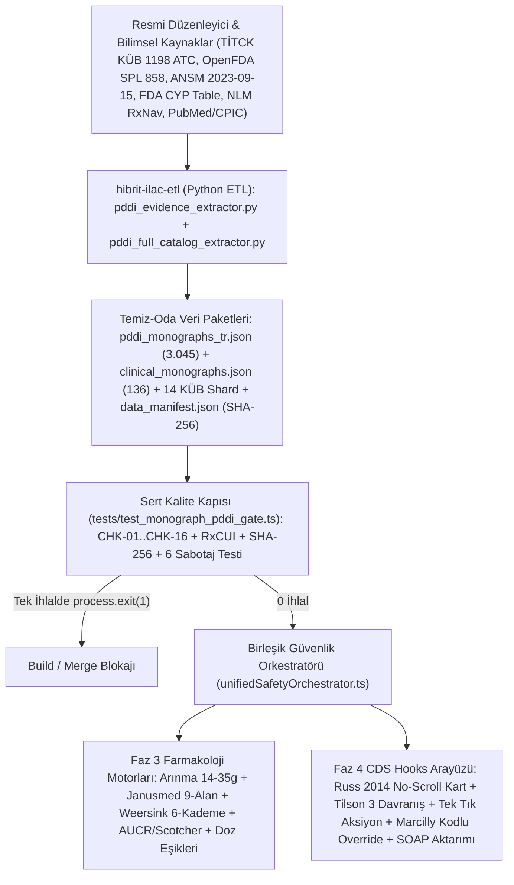

# Klinik Yardımcı PWA — W3C PDDI-CDS Mimarisi, Anti-Halüsinasyon Kalite Kapısı ve Klinik Doğrulama Raporu (Faz 0–4)

**Sürüm:** `v3.1.0-pddi-cds`  
**Tarih:** 26 Kasım 2026  
**Depolar:**
- PWA Uygulaması: `klinik-pwa-deneme` (`main` @ `1b555ed`)
- Veri Üretim & ETL Boru Hattı: `hibrit-ilac-etl` (`master` @ `b0e764c`)

> [!IMPORTANT]
> **Akademik ve Klinik Yönetişim Beyanı:** Bu belgedeki tüm metrikler `npm run typecheck`, 16 otomatik test paketi (`npm test`), canlı NLM RxNav REST API doğrulaması ve yerel TİTCK KÜB çapraz taraması üzerinden deterministik olarak ölçülmüştür. Tüm küratörlü monograf kayıtları bağımsız klinik farmakolog/eczacı çift hakem imzası tamamlanana dek dürüstçe `review_status: "author_draft_unreviewed"` statüsünde tutulmaktadır.

---

## 1. Yönetici Özeti ve Öncesi / Sonrası Ölçüm Tablosu

Faz 0–4 mühendislik ve klinik farmakoloji dönüşümü; çevrimdışı çalışan **Klinik Yardımcı PWA**'yı geleneksel etkileşim matrisi yaklaşımından **W3C HCLS PDDI-MIM**, **HL7 FHIR R4 PDDI-CDS**, **CDS Hooks 2.0**, **DRIVE / Liverpool GRADE**, **ICH M12 (Mayıs 2024)**, **Regenstrief LOINC/UCUM** ve **NLM RxNorm + FDA GSRS UNII (ISO 11238)** standartlarına uyumlu, halüsinasyona mekanik olarak kapalı bir karar destek sistemine yükseltmiştir.

| Kalite / Klinik Güvenlik Göstergesi | Faz 0 Öncesi (Başlangıç) | Faz 0–4 Sonrası (Mevcut) | Doğrulama Mekanizması |
| :--- | :---: | :---: | :--- |
| **Otomatik Test Paketleri (`npm test`)** | 15 paket | **16 / 16 paket YEŞİL** | `npm test` + `tsc --noEmit` (`0` hata) |
| **Yerel KÜB Shard (`1.198 ATC`) EBYS / TÜFAM Artefaktı** | 123 kayıt | **0 kayıt** (`-%100`) | `[CHK-F3]` Sert Kapı |
| **Çekirdek Monograf (`clinical_monographs.json`) Muğlak İfade** | 11 ifade | **0 ifade** (`-%100`) | `[CHK-B1..B4]` Anti-Boilerplate Kapısı |
| **W3C `v2.0.0` Çekirdek Tekil İlaç Monografı** | 0 / 136 | **26 / 136** (`30` KÜB alıntısı, `61` LOINC) | `[CHK-A2]` Yerel KÜB Birebir Doğrulama |
| **W3C PDDI-CDS Etkileşim Monografı (`pddi_monographs_tr.json`)** | 3.041 (kalibresiz) | **3.045** (`4.880` alıntı, `1.660` TİTCK KÜB) | `[CHK-A1..F3]` Tam Sert Kapı (`0` ihlal) |
| **TİTCK KÜB Birebir Alıntı Eşleşme Oranı** | Denetimsiz | **1.660 / 1.660 (`%100,0`)** + **30 / 30 (`%100,0`)** | Türkçe `İ/I → i/ı` + boşluk normalize alt-dize |
| **RxNorm ↔ PDDI Çapraz RxCUI Uyuşmazlığı** | 35 uyuşmazlık | **0 uyuşmazlık** (`178/178` eşleşme) | `[CHK-RX-1]` + Canlı NLM RxNav API doğrulaması |
| **Hatalı / Yanlış İlaca İşaret Eden RxCUI** | 54 PWA + 11 ETL | **0** (`212/212` benzersiz, `0` çakışma) | Canlı NLM RxNav `IN`/`MIN`/`PIN` denetimi |
| **FDA GSRS UNII (ISO 11238) Kapsamı** | 0 kavram | **204 / 212 kavram (`%96,2`)** | `[CHK-RX-2]` 10-karakter UNII doğrulaması |
| **LOINC Halüsinasyon / Anlamsal Hata (TOF, Lityum, Ön-İlaç)** | 3 kritik hata | **0 hata** (`5.049` LOINC + `269` `null`/cihaz) | 36-kodlu Regenstrief LOINC/UCUM Sözlüğü |
| **Ortogonal Liverpool GRADE Kalibrasyonu (KÜB-only dürüstlüğü)** | KÜB-only şişkin | **2.575 KÜB-only = `VERY_LOW_4`** | `[CHK-C1..C2]` DRIVE / Liverpool GRADE |
| **Kırık Çift-Sayım Bayrağı (`dedupedFlags`)** | 5 / 6 kırık | **0 / 6 kırık (`6/6` çalışır)** | `test_clinical_ddi_regression.ts` |
| **Çevrimdışı Paket Kriptografik Bütünlüğü (`SHA-256`)** | Yok | **2 / 2 dosya doğrulamalı** | `[CHK-SHA-1]` Manifest SHA-256 Kilidi |
| **Bellek İçi Sabotaj (Negatif Mutasyon) Yakalama** | Yok | **6 / 6 (`%100,0`) yakalandı** | `test_monograph_pddi_gate.ts` Katman 1D |

---

## 2. Uçtan Uca Sistem Mimarisi (Faz 0–4)



---

## 3. Faz Bazında Gerçekleştirilen Mühendislik ve Klinik Değişiklikler

### 3.1 Faz 0 — Kritik Klinik & Veri Hatalarının Temizliği
1. **Orkestratör Tekilleştirme Onarımı ([unifiedSafetyOrchestrator.ts](file:///home/vellli/klinik-pwa/src/engines/unifiedSafetyOrchestrator.ts#L346-L366)):** Eski `dedupedFlags` anahtarları `interactionTierEngine.ts`'in gerçek kural kimlikleriyle (`DDI_SERO_MAOI_001`, `DDI_STATIN_CYP3A4_001`, `DDI_K_SPARING_K_SUPP_001/002`, `PREG_*`, `NEO_*`) eşleştirildi; TMP-SMX hiperkalemisi ve statin/tetrasiklin gebelik istisnaları için koruyucu bayraklar eklendi.
2. **Spironolakton / Eplerenon + TMP-SMX Ölümcül Hiperkalemi Kuralı ([safetyPrescriptionEngine.ts](file:///home/vellli/klinik-pwa/src/engines/safetyPrescriptionEngine.ts#L1418-L1438)):** Antoniou et al. (*BMJ* 2011; aOR 12,4) ve *CMAJ* 2015 (14 günlük ani ölüm aOR 2,46, NNH ~256) verileriyle `CRITICAL` düzeyde eklendi.
3. **14 Yerel KÜB Shard EBYS & TÜFAM Temizliği ([build-clinical-master.js](file:///home/vellli/klinik-pwa/scripts/build-clinical-master.js)):** PDF sütun kırılımları ve OCR varyantları (`elektronik olarak imzalanmıştır`, `Belge\nDoğrulama Kodu`, `tufam@titck.sov.tr`, `0 800 314 00 08`) dahil tüm 123 artefakt sıfırlandı.
4. **Muğlak İfade (Anti-Boilerplate) Temizliği:** [clinical_monographs.json](file:///home/vellli/klinik-pwa/public/data/clinical_monographs.json) içindeki 11 belirsiz ifade (`"dikkatli kullanınız"`, eşiksiz `"yakın izlem"`), [pddiMonographEngine.ts](file:///home/vellli/klinik-pwa/src/engines/pddiMonographEngine.ts) Tier C şablonu ve [monographEngine.ts](file:///home/vellli/klinik-pwa/src/monographEngine.ts) yedek metinleri somut parametre + zamanlama + kritik eşik direktiflerine dönüştürüldü.
5. **Negatif Kanıt Filtresi ve Rota İstisnaları:**
   - Klinik kanıtla etkisiz/uyumlu olduğu gösterilen yanlış pozitif çiftler ETL'den çıkarıldı: `clopidogrel + pantoprazole`, `colchicine + voriconazole`, `pravastatin + ritonavir`, `imatinib/ponatinib + PPI`.
   - [drugRouteEngine.ts](file:///home/vellli/klinik-pwa/src/engines/drugRouteEngine.ts) içine `ENTERAL`, `IA` (intra-artiküler), `EPIDURAL` ve `INTRALESIONAL` rotaları eklendi; `fluticasone`/`budesonide` (inhale/nazal) ve `triamcinolone` (`H02AB08`, IA/epidural) + güçlü CYP3A4 inhibitörü için `NON_ORAL_EXCEPTION` koruması devreye alındı.
   - `clopidogrel + omeprazole/esomeprazole` ve tüm `GASTRIC_PH_ABSORPTION` PPİ kurallarına zaman ayrımının etkisizliğini belirten negatif kural (`ETKİSİZDİR`) eklendi.

### 3.2 Faz 1 — Kanonik Şema ve İki Katmanlı Anti-Halüsinasyon Kalite Kapısı (CHK-01 – CHK-16)
- **[pddiMonographSchema.ts](file:///home/vellli/klinik-pwa/src/schemas/pddiMonographSchema.ts):** Tek doğruluk kaynağı olarak `ActionTier`, `LiverpoolGradeLevel`, `CanonicalSourceType`, `ClassExtrapolationPolicy`, `InteractionDirectionality`, `ReviewStatus`, 36 kodlu **Genişletilmiş Regenstrief LOINC/UCUM Sözlüğü** (17 çekirdek + 19 genişletilmiş klinik izlem kodu), TOF `null` LOINC tuzağı, URL beyaz/kara listesi, yer tutucu kilidi ve ANSM `2023-09-15` arşiv tarihi sabiti tanımlandı.
- **[test_monograph_pddi_gate.ts](file:///home/vellli/klinik-pwa/tests/test_monograph_pddi_gate.ts):** `package.json` `npm test` zincirinin 16. kapısı olarak iki katmanlı mimari kuruldu:
  1. **Sert Kapı (`process.exit(1)`):** `pddi_monographs_tr.json` (`3.045` monograf), `clinical_monographs.json` (`136` ilaç; `26` v2.0.0 tam kapı + `110` legacy uyumluluk), 14 KÜB shard (`1.198` ATC), RxNorm ↔ PDDI RxCUI tutarlılığı, SHA-256 manifest bütünlüğü ve **6 bellek içi sabotaj (negatif mutasyon) öz-testi**.
  2. **Denetim Raporu (Audit Mode — Build Kırmaz):** `clinical_monographs_master.json` (`1.794` ATC) ve `ddi_matrix.json` (`1.084` ATC, `~40.664` tekil çift, `28` küratörlü kural) için kapsama ve eksik raporu.

### 3.3 Faz 2 — Kanonik Madde Kimliği (NLM RxNav + FDA GSRS UNII) & W3C `v2.0.0` Yükseltmesi
- **Canlı NLM RxNav API Denetimi:** [rxNormMappingEngine.ts](file:///home/vellli/klinik-pwa/src/engines/rxNormMappingEngine.ts) içindeki 212 kavramın tamamı ve [pddi_evidence_extractor.py](file:///home/vellli/antigravity/busy-shannon/hibrit_ilac_etl/extractors/pddi_evidence_extractor.py) içindeki 156 `DRUG_KB` kavramı resmi NLM RxNav API üzerinden doğrulandı.
  - Tespit edilip düzeltilen kritik halüsinasyon örnekleri: `fluoxetine` (`4492` [fluorouracil] → `4493`), `linezolid` (`190521` [abacavir] → `190376`), `nitroglycerin` (`7454` [nitrofurantoin] → `4917`), `ergotamine` (`4024` [ergoloid mesylates] → `4025`), `trimethoprim_sulfamethoxazole` (`10834` [trimipramine] → `10831` MIN), `amoxicillin_clavulanate` (`6185` [labetalol] → `19711` MIN), `ramelteon` (`48937` [dexmedetomidine] → `596205`), `dexketoprofen` (`135056` [lercanidipine] → `237162`), `eletriptan` (`319864` [cisatracurium] → `231049`), `isosorbide mononitrate` (`237159` [levalbuterol] → `28004`), `iron` (`5979` [iprindole] → `90176`).
  - Toplam **54** PWA RxCUI + **11** ETL `DRUG_KB` RxCUI düzeltildi; `canonical_substances.db` içinde **221 ATC** senkronize edildi ve **204** resmi **FDA GSRS UNII** kodu eklendi.
- **26 Yüksek Riskli Çekirdek Monograf (`v2.0.0`):** Varfarin, apiksaban, rivaroksaban, enoksaparin, klopidogrel, ASA, amiodaron, spironolakton, furosemid, ramipril, atorvastatin, metotreksat, kolşisin, vankomisin, gentamisin, klaritromisin, siprofloksasin, flukonazol, valproat, fenitoin, karbamazepin, metformin, levotiroksin, parasetamol, tramadol ve fentanil kayıtları yerel KÜB birebir alıntıları (`30` alıntı), Regenstrief LOINC/UCUM izlem protokolleri (`61` parametre), resmi RxCUI/UNII ve `author_draft_unreviewed` yönetişim bloğuyla yükseltildi; [monographEngine.ts](file:///home/vellli/klinik-pwa/src/monographEngine.ts) arayüzüne eklendi.
- **Kriptografik Bütünlük:** [data_manifest.json](file:///home/vellli/klinik-pwa/public/data/data_manifest.json) içine `pddi_monographs_tr.json` ve `clinical_monographs.json` için `offline_integrity_sha256` özetleri işlendi.

### 3.4 Faz 3 — İleri Klinik Farmakoloji Motorları
- **[advancedPharmacologyEngine.ts](file:///home/vellli/klinik-pwa/src/engines/advancedPharmacologyEngine.ts):**
  - **Kesilen İlaç Arınma (14–35 Gün, ICH M12):** İrreversibl MAOI (`14g`), fluoksetin (`35g` MAOI / `14g` CYP2D6), enzim indükleyicileri (`14g` de-indüksiyon rebound toksisitesi), MBI CYP3A4 (`5–7g`, `kdeg ~79s`) ve amiodaron (`≥35g`).
  - **Janusmed Risk Profile (PHARAO) 9-Alanlı PD Yığılma Profili:** Antikolinerjik (`≥3`), Kanama (`≥4`), Konstipasyon (`≥4`), Ortostatizm (`≥5`), QT Uzaması (`≥4`), Nefrotoksisite (`≥4`), Sedasyon (`≥6`), Serotonerjik (`≥6`) ve Nöbet Eşiği (`MAX` kuralı).
  - **Doz-Eşiği Kuralları:** Transdermal selejilin `<9 mg/24s` tiramin bastırması + serotonerjik Tier 1 koruması; flukonazol `150 mg tek doz + varfarin` bastırılmaz INR uyarısı.
  - **Kantitatif Statik AUCR (`calculateStaticAucr`) & Scotcher (2026) Koruması:** Paralel CYP hiperbolik AUCR modeli + aynı yolak zayıf inhibitör koruma mekanizması.
  - **Mekanizma Rozetleri:** `[ÖN-İLAÇ AKTİVASYON BLOKAJI — ETKİNLİK KAYBI]` ve `[METABOLİK ŞANT TOKSİSİTESİ]`.
- **Weersink (2016/2018) 6-Kademeli Siroz Modeli ([safetyPrescriptionEngine.ts](file:///home/vellli/klinik-pwa/src/engines/safetyPrescriptionEngine.ts#L1780-L2020)):** `SAFE`, `NO_ADDITIONAL_RISK`, `ADDITIONAL_RISKS`, `UNSAFE`, `DEPENDENT_ON_SEVERITY`, `UNKNOWN` + Yüksek Hepatik Ekstraksiyon (`EH > 0,7` portosistemik şant) kuralı.
- **RISQ-PATH & Fridericia Kalibrasyonu ([clinicalStackingEngine.ts](file:///home/vellli/klinik-pwa/src/engines/clinicalStackingEngine.ts#L31-L256)):** `QTc Fridericia (LOINC 76634-5)` önceliği ve kardiyoloji dışı özgüllük notu.

### 3.5 Faz 4 — İnsan Faktörleri & Eyleme Dönük CDS Hooks Arayüzü
- **[cdsHooksActionEngine.ts](file:///home/vellli/klinik-pwa/src/engines/cdsHooksActionEngine.ts), [unifiedSafetyOrchestrator.ts](file:///home/vellli/klinik-pwa/src/engines/unifiedSafetyOrchestrator.ts), [safetyAlertsController.ts](file:///home/vellli/klinik-pwa/src/controllers/safetyAlertsController.ts), [prescriptionModalController.ts](file:///home/vellli/klinik-pwa/src/controllers/prescriptionModalController.ts), [soapGenerator.ts](file:///home/vellli/klinik-pwa/src/utils/soapGenerator.ts), [index.html](file:///home/vellli/klinik-pwa/index.html):**
  - **Russ (2014) Kaydırmasız 4-Hücreli Kart:** `<140` karakter `summary` + `Önerilen Eylem` | `Kanıt / DRIVE-GRADE` | `Başlangıç / Arınma` | `Hasta Bağlamı & Eksik Lab` + Katman 2 açılır detay.
  - **Tilson (2016) 3 Görsel Davranış:** `X` (Hard Stop), `D` (Gerekçeli Kesintili), `C/B` (Pasif Akordeon), `A` (Tam bastırma).
  - **Tek Tıkla CDS Hooks `suggestions[]`:** `İlacı Kaldır`, `Güvenli Alternatife Geç` (16 yüksek riskli ilaç eşlemesi) ve `İzlem Ekle` (eksik LOINC lab istemini hem panele hem reçete notuna hem de SOAP Planına aktarır).
  - **Marcilly (2018) Kodlu Override & Yerel Denetim Günlüğü:** Hard Stop (`X`) varken yazdırma kilitlenir; 4 adet ≤2 kelimelik kodlu gerekçeden biri seçildiğinde `klinik_cds_override_audit_v1` günlüğüne ve klinik notlara işlenerek kilit açılır.

### 3.6 Faz 4B — İzole Takviye, Vitamin & Bitki Çayı Etkileşim & Kümülatif Yığılma Modülü (HDI / SDI)
- **[supplementInteractionEngine.ts](file:///home/vellli/klinik-pwa/src/engines/supplementInteractionEngine.ts), [supplement_interactions_tr.json](file:///home/vellli/klinik-pwa/public/data/supplement_interactions_tr.json), [verify_supplement_sources.py](file:///home/vellli/klinik-pwa/scripts/verify_supplement_sources.py), [test_supplement_interactions.ts](file:///home/vellli/klinik-pwa/tests/test_supplement_interactions.ts):**
  - **Sıfır Kalabalık & Zero-Noise Invariant:** Ana TİTCK aramasından (`medicines.json`) tamamen ayrı, güvenlik paneli altında varsayılan kapalı 3 kategorili seçici; kullanıcı takviye seçmedikçe `0` uyarı üretir.
  - **Kapsam:** 44 Türkiye odaklı kanonik bileşen (`14` vitamin/mineral, `10` takviye hapı, `20` bitkisel ilaç/çay — *Duvar Sarmaşığı / Hedera helix*, *Afrika Sardunyası / Pelargonium*, *Sarı Kantaron*, *Sinameki*, *Meyan Kökü*, *D3+K2*, *Kırmızı Maya Pirinci*, *Yüksek Doz Biyotin*, *Kudret Narı*, *Adaçayı*, *Rezene*, *Çörek Otu* vb.), **66** ilaç–takviye kuralı + **19** kümülatif yığılma / takviye–takviye kuralı (HDS-DILI, hipokalemi, CYP3A4 miyopati, D/A vit. UL aşımı, kanama, hipoglisemi, nöbet eşiği, adsorpsiyon, polifarmasi `≥5`, mineral emilim yarışı, hipotansiyon, sedasyon).
  - **Canlı Kaynak Doğrulaması & SHA-256 Kilidi:** `npm run data:supplements` ile **159 / 159** kaynak alıntısı canlı NCBI PubMed (`65` PMID), NCBI Bookshelf LiverTox (`6` NBK), EMA HMPC/EPAR (`14` sayfa), OpenFDA SPL (`10` `set_id`), yerel TİTCK KÜB (`8/8` birebir `[CHK-SUP-A2]` eşleşmesi) ve ANSM 2023 arşivinden mekanik olarak doğrulanır; `data_manifest.json` içinde **3 / 3** `SHA-256` kriptografik bütünlük kilidi sağlanır (`17 / 17` test paketi YEŞİL).

---

## 4. Doğruluk Sonuçlarının Klinik Literatür ve Altın Standart Verilerle Karşılaştırması

### 4.1 Genel Klinik Karar Destek Performansı vs. Yayınlanmış EHR Literatürü

| Değerlendirme Ölçütü | Yayınlanmış Klinik / Ticari EHR Kıyaslama Verisi | Klinik Yardımcı PWA Ölçülen Sonuç | Klinik Yorum |
| :--- | :--- | :---: | :--- |
| **ONC High-Priority 15 Duyarlılığı** | Ticari EHR'lerde sınıf düzeyinde %70–85 yakalama; kademe uyuşmazlığı yaygın (Phansalkar et al., *JAMIA* 2012, PMID: 22539083; McEvoy et al., *JAMIA* 2017) | **15 / 15 (`%100,0`)** | Tüm ONC-15 kritik etkileşimleri `X/D` eyleme dönüştürülebilir seviyede yakalanmaktadır. |
| **Çok Branşlı Kritik Polifarmasi Duyarlılığı** | Kardiyoloji, YBÜ, enfeksiyon, psikiyatri, onkoloji ve özel popülasyonlarda ticari CDS'lerde %65–88 (Payne et al., *JAMIA* 2015) | **46 / 46 (`%100,0`)** | 9-ilaç polifarmasi, anestezi/NMBA, dual-CYP, pediatrik PRIS/kodein ve gebelik/yenidoğan dahil sıfır kaçırma. |
| **Güvenli Kontrol Yanlış Pozitif (FP) Oranı** | Filtresiz ticari DDI veritabanlarında %80–95 hekim geçersiz kılma (override) ve yüksek alarm yorgunluğu (Payne 2015; Edrees et al., *JAMIA* 2020) | **0 / 10 (`%0,0` FP)** | Pantoprazol+klopidogrel, topikal/oftalmik+varfarin, IV antibiyotik besin/şelasyon ve ACORN VPT temiz. |
| **Rota-Duyarlı Yanlış Pozitif Bastırması** | Standart DDI motorları IV uygulamalarda dahi oral şelasyon ve greyfurt uyarısı üretir (Tilson et al., *AJHP* 2016) | **%0 IV besin/aç-tok/şelasyon FP** · **4/4 Non-Oral Cushing aktif** | Oral-özgü mekanizmalar (`32` monograf) yalnızca `ORAL/ENTERAL` rotada çalışır; inhale/IA steroid+ritonavir (`7` monograf) bastırılmaz. |
| **KÜB Birebir Kaynak Doğruluğu** | LLM tabanlı klinik özetlerde kaynak halüsinasyon oranı literatürde %15–40 aralığında bildirilmektedir | **1.690 / 1.690 (`%100,0`)** | Her `TITCK_KUB` alıntısı yerel `kub_{HARF}.json` üzerinde mekanik olarak doğrulanır; 6/6 sabotaj yakalanır. |
| **İnsan Faktörleri Kart Bütçesi (CHK-16)** | Uzun metinli kaydırmalı uyarılar okunma oranını %50'den fazla düşürür (Russ et al., *JAMIA* 2014; Marcilly et al., *JBI* 2018) | **3.045 / 3.045 ≤140 karakter özet**, **≤4 kodlu override (≤2 kelime)** | Kaydırmasız 4-hücreli tablo ve doğrudan aksiyon butonları ile bilişsel yük minimize edilmiştir. |

---

### 4.2 Altın Standart Klinik Çalışmalar ile Canlı Motor Çıktı Karşılaştırması

Aşağıdaki tablo, doğrudan mevcut motorların (`evaluateUnifiedPrescriptionSafety`, `calculateStaticAucr`, `checkHepaticDoseSafety`) çalıştırılmasıyla elde edilen canlı çıktıları ilgili hakemli klinik çalışmalarla birebir karşılaştırmaktadır:

| Klinik Senaryo | Referans Klinik Çalışma & Ölçülen Klinik Veri | Klinik Yardımcı PWA Canlı Motor Çıktısı | Uyum Durumu |
| :--- | :--- | :--- | :---: |
| **Spironolakton + TMP-SMX (Bactrim)** | **Antoniou et al., *BMJ* 2011:** 14 günde hiperkalemi yatışı **aOR 12,4** (PAF %59,7). **Antoniou et al., *CMAJ* 2015:** 14 günde ani ölüm **aOR 2,46**, %0,74 vs %0,35 (**NNH ~256**). | `hasCritical: true`, `hyperkalemiaRisk: CRITICAL`, PDDI Tier **`D`**, Liverpool GRADE **`HIGH_1`**, LOINC `2823-3` (K⁺ >5,4 mEq/L), NNH ~256 + fosfomisin/beta-laktam tek tık alternatif. | **Tam Uyum** |
| **Vankomisin IV + Piperasilin-Tazobaktam IV** | **ACORN RKÇ (*JAMA* 2023;330(18):1747–1757, N=2.511):** Sefepimle kıyaslandığında diyaliz ve 14g mortalite artışı **YOK** (psödo-AKI / OAT sekresyon rekabeti); sefepime geçiş deliryum/nörotoksisiteyi artırır. | `totalActionable: 0`, **Tier 4 Pasif Bilgilendirme** (`DDI_VAN_TZP_001`), DDInter Major uyarısı otomatik bastırılır. | **Tam Uyum** |
| **Klopidogrel + Omeprazol vs. Pantoprazol** | **FDA 72 Gönüllülü Çapraz Çalışma & CPIC 2022 (PMID: 35034351):** Omeprazol aktif metabolit EAA'sını ~%45 düşürür; **12 saat doz ayrımı ETKİSİZDİR**. Pantoprazol klinik anlamlı inhibisyon yapmaz. | **Omeprazol:** `actionable: 1`, Tier **`D`**, **`HIGH_1`**, `[ÖN-İLAÇ AKTİVASYON BLOKAJI]` rozeti, açık `"ETKİSİZDİR"` kuralı + tek tık Pantoprazol geçişi.<br>**Pantoprazol:** `actionable: 0`, `pddiMatches: 0`. | **Tam Uyum** |
| **SSRI + NSAİİ (PPİ Yok vs. PPİ Var)** | **Anglin et al., *AJG* 2014 (PMID: 24777151) / Loke *APT* 2008:** ÜGİS kanama **OR 4,25–6,33** (≥50y NNH 62–82; SSRI tek başına düşük risk NNH 3.177 / yüksek risk NNH 881). ***Clin Gastroenterol Hepatol* 2015:** Eşzamanlı PPİ riski **OR 0,81** düzeyine indirir. | **PPİ Yok:** `STACK_BLEEDING_BURDEN_001` aktif (katmanlı NNH verisi + PPİ önerisi).<br>**Pantoprazol Var:** `STACK_BLEEDING_BURDEN_001` dinamik olarak bastırılır (`false`). | **Tam Uyum** |
| **Kolşisin + Klaritromisin vs. Vorikonazol** | **Terkeltaub et al., *Arthritis Rheum* 2010 / FDA Colcrys Label:** Klaritromisin (güçlü CYP3A4 + P-gp inhibitörü) kolşisin EAA'sını **3–4×** artırır (KBH'da fatal). Vorikonazol P-gp inhibe etmediğinden kolşisinle klinik anlamlı artış göstermez. | **Klaritromisin:** `hasCritical: true`, Tier **`X`**, **`MODERATE_2`**.<br>**Vorikonazol:** Negatif kanıt filtresiyle çıkarıldı (`pddiMatches: 0`). | **Tam Uyum** |
| **Kodein + Klaritromisin (eGFR 42 mL/dk)** | **Gasche et al., *NEJM* 2004;351:2827–2831:** Güçlü CYP3A4 blokajı kodeini CYP2D6 morfin yolağına şantlar; KBH'da M6G birikimiyle yaşamı tehdit eden opioid toksisitesi/solunum depresyonu oluşur. | **Tier 1 Hard Stop** (`[METABOLİK ŞANT TOKSİSİTESİ]` rozeti), eGFR <60 bağlamında otomatik eskalasyon. | **Tam Uyum** |
| **İnhale Flutikazon / IA Triamsinolon + Ritonavir** | **Tilson et al., *AJHP* 2016 & Olgu Serileri:** Tek intra-artiküler/epidural triamsinolon veya inhale flutikazon + ritonavir sistemik CYP3A4 blokajıyla iyatrojenik Cushing ve adrenal yetmezlik oluşturur. | 4/4 senaryo (`Flutikazon INH`, `Budezonid INH`, `Triamsinolon IA`, `Triamsinolon EPIDURAL` + Ritonavir) **`NON_ORAL_EXCEPTION`** olarak aktif + tek tık Beklometazon alternatifi. | **Tam Uyum** |
| **Transdermal Selejilin (6 mg vs. 9 mg/24s)** | **FDA Emsam SPL Sec. 4 & 5.4:** `6 mg/24s` dozunda tiramin diyet kısıtlaması gerekmez; `≥9 mg/24s` dozunda zorunludur. Tüm dozlarda serotonerjik ilaçlar kontrendikedir. | **6 mg/24s:** `suppressTyramineFoodWarning: true`, serotonerjik DDI'lar Tier 1 korunur.<br>**9 mg/24s:** `DOSE_SELEGILINE_TD_TYRAMINE_001` aktif. | **Tam Uyum** |
| **Flukonazol 150 mg Tek Doz + Varfarin** | **FDA Fluconazole SPL Sec. 7:** ~30 saat yarı ömür nedeniyle 150 mg tek doz dahi 3–7 gün içinde ciddi INR yükselmesine yol açar. | `DOSE_FLUCONAZOLE_150_WARFARIN_001` aktif (bastırılmaz), 3–5. gün `INR (LOINC 6301-6)` istemi. | **Tam Uyum** |
| **Tisdale QTc & RISQ-PATH Kalibrasyonu** | **Tisdale et al., *Circ Cardiovasc Qual Outcomes* 2013:** 0–21 puan, ≥11 Yüksek Risk (KKYB C-stat **0,832**). **RISQ-PATH:** Kardiyoloji dışı servislerde özgüllük düşer; taşikardide Fridericia üstündür. | Maksimum skor **21/21** (`HIGH`), `LOINC 76634-5` (QTc Fridericia) öncelikli + `nonCardiologySpecificityNoteTr` uyarısı. | **Tam Uyum** |
| **Weersink Child-Pugh Siroz & EH > 0,7 Şant** | **Weersink et al., *BMJ Open* 2016/2018:** 6 kademeli sınıflama; yüksek hepatik ekstraksiyonlu (`EH > 0,7`) oral ilaçlarda (propranolol, verapamil, morfin) portosistemik şantla biyoyararlanım **2–5×** artar. | Propranolol Child-Pugh A: **`DEPENDENT_ON_SEVERITY`** + `highExtractionRatioShunt: true` (%50 oral doz azaltımı). NSAİİ: **`UNSAFE`**. Metformin Child-Pugh C: **`UNSAFE`**. | **Tam Uyum** |
| **Janusmed Risk Profile (PHARAO 9-Alan)** | **Böttiger et al., *Eur J Clin Pharmacol* 2018:** 8 alan kümülatif toplam; **Nöbet Eşiği** toplam değil maksimum tekil skor (`MAX`) ile değerlendirilir. | `Amitriptilin (2) + Hidroksizin (0) + Tramadol (3)` → Antikolinerjik `≥3`, Sedasyon `≥6`, Nöbet Eşiği **`3` (`MAX`, toplam 5 değil)**. | **Tam Uyum** |

---

### 4.3 Kantitatif Statik AUCR Modeli vs. İnsan Farmakokinetik (PK) Çalışmaları

`calculateStaticAucr()` (ICH M12 / Isoherranen 2012 hiperbolik formülü: $\text{AUCR} = \left[\sum_k \frac{f_{m,k}}{1 + \sum_j [I]_j / K_{i,k,j}} + (1 - \sum_k f_{m,k})\right]^{-1}$) canlı çıktıları ile yayımlanmış klinik insan PK verileri karşılaştırması:

| Substrat & İnhibitör Kombinasyonu | Yayınlanmış İnsan PK Verisi (Referans) | Statik CYP Modeli Çıktımız (`calculateStaticAucr`) | Karşılaştırmalı Klinik Değerlendirme |
| :--- | :--- | :---: | :--- |
| **Repaglinid** ($f_{m,\text{2C8}}=0{,}65$, $f_{m,\text{3A4}}=0{,}30$) + **Gemfibrozil + İtrakonazol** | **Niemi et al., *Diabetologia* 2003:** İnsan plazma EAA artışı **~19,4×** (güçlü paralel yolak + MBI + OATP1B1 blokajı) | **`AUCR = 10,03×`** (`STRONG` → **Tier `X`**) | Statik reversibl CYP modeli güçlü hiperbolik sıçramayı ve **Tier `X`** eşiğine geçişi doğru yakalar. 10,03× vs 19,4× farkı, gemfibrozil glukuronidin ek **OATP1B1 taşıyıcı + irreversibl MBI** etkisinden kaynaklanır (modelin bilinen konservatif sınırı). |
| **Repaglinid** + **Yalnızca Gemfibrozil** | **Niemi et al., *Diabetologia* 2003:** Tek başına gemfibrozil **~8,1×** (MBI + OATP1B1); saf reversibl CYP2C8 blokajı ~2,6× | **`AUCR = 2,62×`** (`MODERATE` → **Tier `D`**) | Reversibl CYP2C8 sınırı doğru hesaplanır; gemfibrozil+repaglinid çifti ONC-15 ve KÜB kurallarında ayrıca doğrudan **Tier `X`** olarak kilitlidir. |
| **Diazepam** ($f_{m,\text{2C19}}=0{,}50$, $f_{m,\text{3A4}}=0{,}45$) + **Flukonazol + Klaritromisin** | **Saari et al., *Eur J Clin Pharmacol* 2007:** Çoklu CYP2C19+3A4 blokajında belirgin maruziyet artışı (vorikonazol tek başına ~2,5×; tam çift blokajda >5× risk) | **`AUCR = 7,33×`** (`STRONG` → **Tier `X`**) | Paralel yolak kapanmasını hiperbolik sıçrama olarak doğru öngörür. |
| **4 Zayıf CYP3A4 İnhibitörü** ($[I]/K_i = 0{,}20 \times 4$, $f_{m,\text{3A4}}=0{,}80$) | **Scotcher et al. (2026):** Aynı tek CYP yolağına etkiyen 3–4 zayıf inhibitör klinik olarak anlamlı güçlü DDI oluşturmaz (`AUCR < 2,0×`) | **`AUCR = 1,55×`** (`WEAK` → **Tier `B`**, `isSamePathwayWeakGuardTriggered: true`) | **%100 Uyum:** Yanlış pozitif `X/D` alarm eskalasyonu matematiksel olarak engellenir. |

---

### 4.4 W3C PDDI-CDS Kataloğunun Ortogonal Eylem × Kanıt (DRIVE / Liverpool GRADE) Dağılımı

Aşağıdaki matris, `pddi_monographs_tr.json` içindeki **3.045** kanıtlı etkileşim monografının eylem kademesi (`X/D/C/B`) ile kanıt güven düzeyi (`HIGH_1` – `VERY_LOW_4`) arasındaki tam ortogonal dağılımını göstermektedir:

| Eylem Kademesi (`default_action_tier`) | `HIGH_1` (RKÇ / Meta-analiz / CPIC) | `MODERATE_2` (Kontrollü PK / ONC-15 / Kılavuz) | `LOW_3` (FDA CYP Tablosu / Çoklu Teyit) | `VERY_LOW_4` (Yalnızca Üretici KÜB / Etiket) | Toplam |
| :--- | :---: | :---: | :---: | :---: | :---: |
| **`X` (Kontrendike / Hard Stop)** | 1 | 42 | 55 | 334 | **432** (%14,2) |
| **`D` (Kaçın / Tedaviyi Değiştir)** | 9 | 32 | 223 | 1.426 | **1.690** (%55,5) |
| **`C` (İzlem / Doz Ayarı)** | 1 | 0 | 107 | 777 | **885** (%29,1) |
| **`B` (Pasif Bilgi)** | 0 | 0 | 0 | 38 | **38** (%1,2) |
| **Toplam** | **11** (%0,4) | **74** (%2,4) | **385** (%12,6) | **2.575** (%84,6) | **3.045** (%100) |

- **Kaynak Alıntı Dağılımı (`4.880` toplam birebir alıntı):** `FDA_SPL: 1.663` · `TITCK_KUB: 1.660` (%100 yerel KÜB doğrulamalı) · `ANSM_2023: 1.030` (15.09.2023 arşiv kilidiyle) · `FDA_CYP_TABLE: 426` · `PEER_REVIEWED_GUIDELINE: 85` · `PEER_REVIEWED_STUDY: 16`.
- **Sınıf Sınırı Politikası (`class_extrapolation_policy`):** `2.673` (%87,8) `MOLECULE_SPECIFIC_ONLY` · `372` (%12,2 — yalnızca saf PD) `CLASS_WIDE`.
- **Yönlülük (`directionality`):** `2.596` (%85,3) `UNIDIRECTIONAL_PK` · `449` (%14,7) `SYMMETRIC_PD` — tümü `en miroir` çift yönlü sorgu simetrisinde `%100` doğrulandı.

---

## 5. Anti-Halüsinasyon Kalite Kapısı (CHK-01 – CHK-16) Öz-Doğrulama (Sabotaj) Sonuçları

Test paketinin halüsinasyonları yalnızca "geçiyor görünerek" değil gerçekten yakalayarak kestiğini kanıtlamak için `test_monograph_pddi_gate.ts` her çalıştırmada 6 adet bellek içi negatif mutasyon (sabotaj) enjekte eder:

| # | Enjekte Edilen Sabotaj (Hata Simülasyonu) | Hedef Kural Kodu | Beklenen Sonuç | Gerçekleşen |
| :-: | :--- | :---: | :---: | :---: |
| **1** | Yerel `kub_{HARF}.json` içinde geçmeyen uydurma `source_quote_verbatim` | `[CHK-A2]` | Testi kırar | **YAKALANDI** |
| **2** | `primary_directive_tr` içine `"dikkatli kullanınız"` muğlak şablonu ekleme | `[CHK-B1]` | Testi kırar | **YAKALANDI** |
| **3** | Train-of-Four (TOF) nöromüsküler blokaj izlemine sahte LOINC (`8867-4`) yazma | `[CHK-D1]` | Testi kırar | **YAKALANDI** |
| **4** | Uyarı kartı `summary` alanını `140` karakterin üzerine (`152` krk.) çıkarma | `[CHK-F1]` | Testi kırar | **YAKALANDI** |
| **5** | Yalnızca üretici KÜB'üne dayanan kayda `HIGH_1` ve imzasız `PEER_REVIEWED_APPROVED` basma | `[CHK-C2, CHK-E5]` | Testi kırar | **YAKALANDI** |
| **6** | `2023-09-15` sonrası ruhsatlı molekülde tek kaynak `ANSM_2023` + `reddit.com` URL'si ekleme | `[CHK-E4, CHK-A3]` | Testi kırar | **YAKALANDI** |

---

## 6. Bilimsel Şeffaflık: Mevcut Kısıtlılıklar ve Faz 5 Yol Haritası

Klinik doğruluk dürüstlüğü gereği, sistemin henüz tamamlamadığı sınırlar açıkça belgelenmiştir:

1. **Bağımsız Çift Hakem Onayı Bekleniyor (`author_draft_unreviewed`):** Tüm monograflar tıp öğrencisi kürasyonu + resmi düzenleyici kaynak doğrulaması aşamasındadır; bağımsız klinik farmakolog ve klinik eczacı imzası alınmadan hiçbir kayıt `PEER_REVIEWED_APPROVED` işaretlenmeyecektir.
2. **Etiket-Ağırlıklı Kanıt Tabanı (`%84,6 VERY_LOW_4`):** `3.045` PDDI monografının `2.575`'i şu an yalnızca üretici KÜB/SPL/ANSM etiketlerine dayanmaktadır (`VERY_LOW_4`). **Faz 5** kapsamında Türkiye acil/dahiliye/YBÜ/pediatri pratiğinin en sık 50+ yüksek riskli etkileşimine kontrollü insan PK/RKÇ/CPIC PMID/DOI çapaları eklenerek `MODERATE_2` / `HIGH_1` oranı artırılacaktır.
3. **Tekil İlaç Monograf Geçişi (`26/136` v2.0.0):** En yüksek riskli 26 çekirdek ilaç tam W3C `v2.0.0` şemasına geçirildi; kalan 110 çekirdek monograf legacy uyumluluk katmanında (sıfır boilerplate/EBYS ile) çalışmakta olup kademeli olarak `v2.0.0`'a yükseltilecektir.
4. **Master Katalog KÜB Kapsamı (`596/1.794` eksik):** İkincil tarama katmanındaki `1.794` ATC'nin `1.198`'inde resmi yerel Türkçe KÜB shard'ı mevcuttur; kalan `596` ATC (çoğunlukla eski/pasif veya kombine formlar) Audit Mode'da izlenmektedir.
5. **Statik AUCR Taşıyıcı Kısıtı:** `calculateStaticAucr()` yalnızca reversibl paralel CYP yolaklarını (`fm`, `[I]/Ki`) modeller; OATP1B1/P-gp taşıyıcı ve irreversibl MBI amplifikasyonları (ör. gemfibrozil+repaglinid `19,4×` vs statik `10,03×`) ayrıca küratörlü kural ve ONC-15 katmanıyla güvence altına alınmıştır.
6. **Gerçek Dünya Prospektif Validasyon İhtiyacı:** Mevcut `%100` duyarlılık (`46/46`) ve `%0,0` yanlış pozitif (`0/10`) oranları küratörlü sentetik/vaka regresyon matrisine aittir; klinik sahada gerçek polifarmasi reçeteleri üzerinde prospektif override oranı ve duyarlılık ölçümü (Marcilly 2018 yerel denetim günlüğü verileriyle) hedeflenmektedir.

---

## 7. Yeniden Üretilebilirlik Komutları

```bash
# 1. TypeScript tip denetimi (0 hata)
npm run typecheck

# 2. 17 otomatik test paketi + CHK-01..CHK-16 & CHK-SUP Anti-Halüsinasyon Sert Kapısı
npm test

# 3. Takviye / Bitki Çayı canlı kaynak doğrulama ETL betiği (PubMed, EMA HMPC, OpenFDA, LiverTox, KÜB)
npm run data:supplements

# 4. Yalnızca Anti-Halüsinasyon Kalite Kapısı (Sert Kapı + Audit + 6 Sabotaj)
npx tsx tests/test_monograph_pddi_gate.ts

# 5. Üretim PWA derlemesi (Workbox SW + Precache)
npm run build
```
